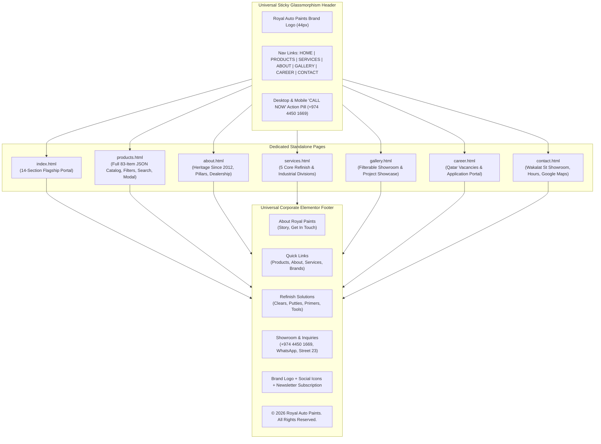

# Royal Auto Paints Qatar — Architectural Blueprint & Technical Specification (Flagship Redesign v4.0)

**Project Name:** Royal Auto Paints Qatar Website Flagship Redesign  
**Base Architecture:** High-Performance ThemeMascot Modern Luxury Framework / Custom Responsive Core / GSAP ScrollTrigger / Swiper.js / TwentyTwenty Slider / Standalone JSON-Driven Catalog Engine  
**Active Workspaces:**  
- `D:\manu\projects\royal_paints_1` (Primary Production Workspace)  
- `D:\manu\projects\royalautopaintsre` (Staging & Live Server Workspace: `http://127.0.0.1:5500/`)  
**Live Production Domain:** `https://www.royalautopaints.com/`  
**Physical Headquarters:** Street 23, Wakalat St, Industrial Area, Doha, Qatar  
**Direct Contacts:** Tel: `+974 4450 1669` | WhatsApp RFQ: `+974 5039 5741` | Email: `info@royalautopaints.com` / `royalpaints.qa@gmail.com`  
**Current Milestone:** Complete Production Flagship Integration v4.0 — 14 Homepage Sections, 5-Card GSAP ScrollTrigger Pinning, TwentyTwenty Comparison, Swiper Featured Carousel, Full 83-Item Dynamic JSON Product Catalog (`products.html`), Navbar Cross-Linking, and 100% Elementor Corporate Footer Parity with Straight Seam Bottom Corners.

---

## 1. Executive Summary & Evolution History

Established in 2012 in the Doha Industrial Area, **Royal Auto Paints (Al-Haram Paints & Trading)** is Qatar's premier authorized distributor of world-class automotive refinish systems, commercial spray booth equipment, marine and yacht coatings, industrial protective coatings, and luxury wood finishes. The company represents global industry leaders including **HB Body, Axalta Challenger, Motolux, and Sea-Line**.

### The Redesign Evolution
1. **v1 (Legacy Site):** High organic SEO rankings and strong local authority, but dated layout, non-responsive design, and limited interactive product capability.
2. **v2 (Zay Shop Redesign):** Clean, minimalist Bootstrap framework (`zay_royal_paint_template_stock`) with custom corporate colors and structured sections.
3. **v3 (Luxury Flagship Redesign):** High-end corporate experience featuring interactive synchronized micro-sliders, authentic high-resolution studio photography, modern glassmorphism badges, and brand-first Royal Oceanic Navy & Paint Splash Warm Orange accents.
4. **v3.5 (Modern Interactive Engine):**
   - **GSAP ScrollTrigger Pinned Services Showcase:** 5 pinned division cards (Automotive Refinish, Spray Booth Engineering, Marine & Yacht Coatings, Industrial Protective Coatings, Luxury Wood Paints) with progressive stacking and seamless forward/reverse scroll pinning.
   - **Why Clients Trust Royal Auto Paints:** Refined organic curved mask with high-resolution spray mist photography, 4 capability feature boxes, and animated wholesale quote triggers.
   - **Stats Counter Section ("Our Experience Speaks for Itself"):** 4 high-credibility B2B automotive coating metrics with smooth scroll-animated counters and clean 1px vertical straight separators.
   - **Before & After Real Automotive Refinish Results:** Interactive TwentyTwenty comparison slider demonstrating factory-finish paint restoration on high-res vehicle imagery.
   - **Featured Products Showcase & Slider (`#products`):** Interactive Swiper carousel displaying 6 authentic Royal Auto Paints coatings (HB Body 691, HB Body F202, Challenger CL240, HB Body C496, HB Body C493, HB Body U951) with clean minimalist studio presentation.
5. **v4.0 (Full Flagship Production & Catalog Portal — Current Standard):**
   - **Full 83-Item Dynamic Product Catalogue (`products.html`):** Complete automotive refinish catalog powered by `data/products.json` and resilient `js/products-data.js` fallback (`window.royalProducts`). Features live instant search, 8 category filter pills with dynamic count badges, 19-brand dropdown filter, 4 sorting modes, pagination (16 per page + "Show All 83" toggle), and high-definition Quick View modal.
   - **Universal Navbar Direct Linking:** Desktop navigation bar (`.luxore-nav-link`), mobile drawer menu, and corporate footer quick links explicitly connect "PRODUCTS" directly to `products.html` across all website pages.
   - **Elementor Corporate Footer Parity:** Extracted and applied the exact `index.html` Elementor corporate footer (`<footer id="footer" class="footer ">`) to `products.html`, backed by all necessary Elementor core stylesheets (`custom-frontend.min.css`, `elementor-post-1693.css`, `navigation-menu.css`, etc.) for seamless 4-column layout parity.
   - **Zero-Radius Bottom Seam:** Clean vertical junction between the light blue container (`.elementor-element-ecae855`) and the lower dark copyright strip with `border-bottom-left-radius: 0 !important; border-bottom-right-radius: 0 !important;`.
   - **Genuine Contact Verification:** Verified landline `+974 4450 1669`, WhatsApp `+974 5039 5741`, email `info@royalautopaints.com`, and physical Doha Industrial Area address across all footer blocks and schemas.
   - **Floating Quick Actions Stack:** Static, non-flashing WhatsApp button (`#25D366`) and Deep Royal Navy (`#0A2942`) scroll-to-top button with smooth scroll physics.
   - **Authentic Brand Favicon Suite:** Multi-resolution icons (`favicon.ico`, 32×32, 16×16, Apple touch icons) generated from the official brand swirl emblem.

---

## 2. Core Visual Identity & Design System

The visual design system merges industrial durability with automotive prestige, dominated by **Industrial Charcoal & Precision Grays** (derived directly from the "AUTO PAINTS" `#58585A` branding) and energized with **High-Visibility Automotive Racing Gold/Yellow (`#FFB800` / `#F59E0B`)**, completely eliminating any teal blue tones:

```
┌────────────────────────────────────────────────────────────────────────┐
│     ROYAL AUTO PAINTS MASTER COLOR SYSTEM (INDUSTRIAL GRAY & GOLD)     │
├───────────────────┬───────────────────┬────────────────────────────────┤
│ Token Name        │ Hex Code          │ UI Application                 │
├───────────────────┼───────────────────┼────────────────────────────────┤
│ Industrial Charcoal│ #22272F          │ Dominant Dark, Section Titles, │
│ (--royal-gray-ch) │                   │ Main Header & Primary Badges   │
├───────────────────┼───────────────────┼────────────────────────────────┤
│ Carbon Darkest    │ #14171C           │ Deepest Hero Canvas & Footer BG│
├───────────────────┼───────────────────┼────────────────────────────────┤
│ Slate Gray Dark   │ #333A45           │ Dark Card Surfaces & Borders   │
├───────────────────┼───────────────────┼────────────────────────────────┤
│ Logo Graphite Gray│ #58585A           │ Logo "AUTO PAINTS" text, specs │
│ (--royal-gray)    │                   │ and technical metadata chips   │
├───────────────────┼───────────────────┼────────────────────────────────┤
│ Automotive Racing │ #FFB800           │ High-Visibility Signature Gold,│
│ Gold/Yellow       │                   │ Active Badges, CTA Hover Glow  │
├───────────────────┼───────────────────┼────────────────────────────────┤
│ Deep Golden Amber │ #F59E0B           │ High-contrast active borders   │
├───────────────────┼───────────────────┼────────────────────────────────┤
│ Technical Silver  │ #F4F6F8           │ Precision Light Section Canvas │
├───────────────────┼───────────────────┼────────────────────────────────┤
│ Official WhatsApp │ #25D366           │ Static WhatsApp Floating CTA   │
├───────────────────┼───────────────────┼────────────────────────────────┤
│ Pure Card White   │ #FFFFFF           │ Product Cards, Capability Boxes│
├───────────────────┼───────────────────┼────────────────────────────────┤
│ Subtle Border Gray│ #E2E8F0           │ Component Separators & Dividers│
└───────────────────┴───────────────────┴────────────────────────────────┘
```

### Brand Typography Standards
- **Primary Serif Headlines:** `Marcellus`, serif — Used for brand authority headings, section titles, and product card titles.
- **Modern Sans Metadata & Body:** `DM Sans`, sans-serif — Used for navigation links, descriptive text, technical specifications, and filter pills.

### Key UI Architecture Rules
1. **Button Arrow-Reveal Animation & Spacing Guard (`.btn-style1`, `.btn-style2`):**
   - High-end pill buttons featuring dual hidden/visible SVG arrows (`height: 56px; border-radius: 50px`).
   - Normal State: Left arrow badge hidden (`scale: 0.3; opacity: 0; left: 8px`), right arrow badge visible (`width: 40px; margin-left: 14px`), button padding `0 16px 0 32px`.
   - Hover State: Button transitions to Racing Gold gradient (`#FFB800` to `#F59E0B`), text color shifts to Industrial Charcoal (`#14171C`), left arrow badge expands (`scale: 1; left: 8px; background: #14171C`) displaying a razor-sharp crisp white arrow (`stroke: #FFFFFF`), and right arrow badge cleanly collapses (`width: 0; scale: 0`).
   - Padding & Spacing Guard: Padding dynamically shifts to `padding-left: 58px !important; padding-right: 32px !important;` with `transform: none !important;` on text. This preserves an exact 32px breathing room between the text and the right rounded pill edge, completely preventing text overlap or boundary collision regardless of button text length.
2. **Standardized Card Geometry:**
   - 20px uniform rounded corners on homepage product cards and service division containers (`border-radius: 20px`).
   - 18px rounded corners on catalog product cards with soft ambient elevation (`box-shadow: 0 10px 30px rgba(10, 41, 66, 0.06)`).
   - Dynamic hover lift (`transform: translateY(-8px)`) with heightened shadow.
3. **Pill Eyebrow Subtitles:**
   - Centered pill badges (`background-color: #FFFFFF`, padding `7px 22px`, `border-radius: 50px`, box-shadow `0 2px 12px rgba(0,0,0,0.05)`).
   - Preceded by a circular orange accent dot (`width: 7px; height: 7px; background-color: #F68C50; border-radius: 50%`).
4. **Gold Star Rating Standards:**
   - Universal 5-star rating using Font Awesome 5 Free (`\f005`) in `#ffa700` with 100% fill width.

---

## 3. Information Architecture & Multi-Page Topology

The website operates as a high-performance multi-page portal with 7 dedicated HTML pages synchronized with direct cross-page navigation:



### Multi-Page Route Matrix
| URL Route | Page Title | Primary Capabilities & Content Focus | Navigation Integration |
| :--- | :--- | :--- | :--- |
| `index.html` | Home — Royal Auto Paints | Flagship interactive portal: 5-Slide Hero, 5-Division GSAP Pinning Showcase, Why Choose Us, Animated Stats, Before/After Slider, Featured Swiper Carousel, Reviews, Brands, Location & Footer. | Links to `products.html` via Top Nav, Mobile Drawer, and Footer Quick Links. |
| `products.html` | Products Catalogue | Full 83-item automotive catalog powered by JSON, 8 category filter pills, brand dropdown, instant search, pagination, HD Quick View modal, and Elementor corporate footer. | Top Nav highlights `PRODUCTS` in Warm Orange `#F68C50`. |
| `about.html` | About Us | Heritage in Doha Industrial Area since 2012, authorized Qatar dealership for HB Body & Challenger, technical pillars, team and facility photography. | Full navigation parity; direct link to `products.html`. |
| `services.html` | Specialized Services | In-depth engineering specifications for OEM color matching, spray booths, marine coatings, wood finishes, and industrial protective barriers. | Full navigation parity; direct link to `products.html`. |
| `gallery.html` | Project Gallery | Visual showcase with category filter tabs for collision centers, commercial spray booths, yacht refinishing, and industrial steel coatings. | Full navigation parity; direct link to `products.html`. |
| `career.html` | Careers & Openings | 4 authentic Qatar job vacancies (Color Mixing Technician, B2B Sales Executive, Spray Booth Maintenance Specialist, Warehouse Logistics Coordinator) with direct CV application form. | Full navigation parity; direct link to `products.html`. |
| `contact.html` | Contact Us & Showroom | Street 23 Wakalat St showroom details, operating hours, responsive Google Maps iframe, and technical inquiry dispatch form. | Full navigation parity; direct link to `products.html`. |

---

## 4. Homepage Section Hierarchy & Specifications

```mermaid
flowchart TD
    S1["1. Top Utility Header\n(Doha Industrial Area, Direct Phones, Email Desk)"]
    S2["2. Main Sticky Navigation\n(Brand Logo, Direct Links to Subpages, 'CALL NOW' Pill)"]
    S3["3. Synchronized 5-Division Hero Banner\n(Dynamic Full-Width Slider + Interactive Mini-Card Card)"]
    S4["4. 'Who We Are' Heritage & Strength Section\n(3-Photo Collage, 2012 Doha History, Spectrophotometer Lab Copy)"]
    S5["5. Pinned Services Showcase (GSAP ScrollTrigger)\n(5 Stacking Cards: Automotive, Booths, Marine, Industrial, Wood)"]
    S6["6. Why Clients Trust Royal Auto Paints\n(Curved Arched Mask, 4 Capability Boxes, Wholesale Quote Button)"]
    S7["7. Animated Experience Counters\n(500+ Workshops, 99% OEM Match, 4.9 Rating, 800+ Projects)"]
    S8["8. Before & After Refinish Results\n(Interactive TwentyTwenty Draggable Split Slider)"]
    S9["9. Featured Products Showcase & Slider (#products)\n(6 Editorial Studio Coatings, 5 Stars, Swiper Carousel, Link to products.html)"]
    S10["10. How It Works / Technical Refinish Steps\n(Consultation, Spectrophotometer Lab, Batch Formulation, Delivery)"]
    S11["11. Customer Reviews & Google Reputation\n(Verified 4.7-Star Rating, 91+ Reviews, Technician Visual)"]
    S12["12. Technical FAQ & Consultation Desk\n(Accordion FAQs, Heat Mixing Advice, Delivery Info)"]
    S13["13. Dealership & Authorized Brands Showcase\n(Physical Storefront, Challenger, HB BODY, Authenticity)"]
    S14["14. Trusted By Leading Brands Carousel\n(HB Body, Axalta, Challenger, Motolux, Sea-Line)"]
    S15["15. Corporate Consultation & RFQ Form\n(Collision Center Inquiry Desk, Phone & WhatsApp Shortcuts)"]
    S16["16. Corporate Footer & Doha Location\n(Street 23 Headquarters, Operating Hours, Google Maps, Legal Badges)"]

    S1 --> S2 --> S3 --> S4 --> S5 --> S6 --> S7 --> S8 --> S9 --> S10 --> S11 --> S12 --> S13 --> S14 --> S15 --> S16
```



---

## 5. Detailed Component Specifications

### 5.1 Universal Luxury Navigation Header
- **Full-Width Glassmorphism Architecture:**
  - **Top Navigation State (Hero Overlay):**
    - Seamless full-width container (`max-width: 1720px`, `height: 80px`, `padding: 0 50px`).
    - Frosted oceanic glass material: `background: rgba(8, 28, 46, 0.45)` with `backdrop-filter: blur(18px) saturate(170%)`.
    - Specular highlight edge: `border-bottom: 1px solid rgba(255, 255, 255, 0.16)` and inner glass reflection `inset 0 1px 0 rgba(255, 255, 255, 0.14)`.
    - Authentic white brand logo (`royal-nav-logo-white`), crisp white `DM Sans` links with underline hover sweep, and luxury frosted glass call button (`rgba(255, 255, 255, 0.12)`).
  - **Sticky Scrolled Navigation State (`.sticky-active`):**
    - Automatically triggered when scrolling past 75px, sliding down smoothly via `stickyNavSlideDown`.
    - Full-width fixed porcelain glass bar (`top: 0; left: 0; right: 0; width: 100%; height: 72px; z-index: 99999`).
    - High-clarity frosted glass material: `background: rgba(255, 255, 255, 0.78)` with `backdrop-filter: blur(20px) saturate(180%)`, `border-bottom: 1px solid rgba(255, 255, 255, 0.45)`, and ambient elevation `0 10px 35px rgba(10, 41, 66, 0.08)`.
    - Seamlessly displays full-color dark brand logo (`royal-nav-logo-dark`), Deep Royal Navy (`#0A2942`) navigation links with warm orange (`#F68C50`) hover, and solid Royal Navy call button.
  - **Navbar Link Standards:**
    - Desktop: `<li><a href="products.html" class="luxore-nav-link">PRODUCTS</a></li>`
    - Mobile: `<li><a href="products.html">PRODUCTS</a></li>`
    - Subpages: Active page indicator highlighted in `#F68C50`.

### 5.2 Featured Products Showcase & Slider (`#products` on `index.html`)
- **Container:** `.elementor-element-257125c` with `id="products"` and distinct crisp white background (`#FFFFFF`).
- **Product Card Architecture (`.tm-woo-product-style1`):**
  - Tall vertical portrait card (`border-radius: 20px`, `padding: 12px 12px 20px 12px`, 1px border `rgba(10, 41, 66, 0.08)`, ambient shadow `0 10px 30px rgba(10, 41, 66, 0.06)`).
  - Portrait image container (`height: 310px`, `border-radius: 16px`, `overflow: hidden`, `object-fit: cover`).
  - Centered product title in `Marcellus`, 18px, `#0A2942`.
  - Dedicated action button below carousel (`VIEW ALL PRODUCTS`) linking directly to `products.html`.
- **6 Featured Items:** HB Body 691 HS SR Clear, HB Body Pro F202 Zinc Plus, Challenger CL240 2K Clear, HB Body C496 2K HS Clear, HB Body Pro C493 Matt Clear, HB Body U951 Auto Flex.

### 5.3 Full Dynamic Product Catalogue (`products.html`)
- **Dataset Architecture (`data/products.json` & `js/products-data.js`):**
  - Dynamic catalog powered by structured JSON comprising **83 genuine automotive refinish products**.
  - Dual-loading mechanism: Async `fetch('data/products.json')` for HTTP/HTTPS servers, with graceful fallback to `window.royalProducts` (`js/products-data.js`) for offline and `file://` local execution.
  - Comprehensive metadata per product: `id`, `name`, `brand`, `category`, `categoryName`, `image` (local PNG with remote CDN fallback), `badge`, `desc`, `features` array, and `specifications` object.
- **8 Category Filter Pills (with Live Counts):**
  1. *All Products* (`all` — 83 products)
  2. *Primers & Fillers* (`fillers` — 19 products)
  3. *Solvents & Underbody* (`solvents` — 13 products)
  4. *Polishing & Detailing* (`polishing` — 11 products)
  5. *Equipment & Tools* (`tools` — 11 products)
  6. *Clear Coats & Topcoats* (`clearcoats` — 9 products)
  7. *Hardeners & Activators* (`hardeners` — 9 products)
  8. *Paint & Aerosols* (`paints` — 7 products)
  9. *Masking & Protection* (`masking` — 4 products)
- **Search, Filtering, and Sorting Controls:**
  - Real-time instant search input matching names, codes (e.g., C496, 615, CL240), and descriptions.
  - Brand filter dropdown listing all 19 catalog brands (HB Body, Challenger, Axalta, Mirka, 3M, Farecla, etc.).
  - Sort selector: Default Catalogue Order, Name A-Z, Name Z-A, Brand A-Z.
  - Active filter tags with one-click clear all filters.
- **Pagination Engine:**
  - Standard view: 16 cards per page with numeric page buttons and Previous/Next chevrons.
  - "Show All 83" toggle allowing users to view the entire catalog at once.
- **Product Card Presentation (`.luxore-product-card`):**
  - Crisp white card (`#FFFFFF`, `border-radius: 18px`, 1px border `rgba(10, 41, 66, 0.08)`).
  - High-res product image with subtle hover zoom and local-to-CDN fallback error handling.
  - Brand badge, category tag, Marcellus serif title, short specification summary, and spec pills.
  - Direct WhatsApp RFQ button pre-populated with product name and code.
  - "Quick View" trigger opening the detailed inspection modal.
- **HD Quick View Modal:**
  - Full-resolution product imagery with zoom capability.
  - Complete technical specifications table (Volume, Mixing Ratio, Dry Time, VOC, Application).
  - Direct WhatsApp RFQ trigger + Direct phone call shortcut (`+974 4450 1669`).
  - Resilient modal architecture: Bootstrap 5 modal with automatic vanilla JS fallback ensuring 100% reliability regardless of library loading order.

### 5.4 Elementor Corporate Footer Parity (`#footer`, `.footer`)
- **Visual & Structural Parity:**
  - Standardized across `index.html` and `products.html` using the exact Elementor container markup:
    - Outer container: `.elementor-element-00ae94a` (`width: 100% !important; background: transparent !important;`).
    - Upper main footer container: `.elementor-element-ecae855` in Deep Royal Navy (`#0A3254`).
    - 4-Column Flex Layout (`.elementor-element-2c0d036`):
      1. **About Royal Paints:** Company background, official authorized partner statement, and "GET IN TOUCH" pill button.
      2. **Quick Links:** Direct navigation links to About, Product Catalog (`products.html`), Color Matching Lab, Authorized Brands, and Contact.
      3. **Refinish Solutions:** 2K Basecoats, High-Solid Clears, Primers & Putties, Abrasives & Masking, Spray Guns.
      4. **Showroom & Mixing Lab + Direct Inquiries:** Physical address (Street 23, Wakalat St, Industrial Area, Doha, Qatar), Landline `+974 4450 1669`, WhatsApp `+974 5039 5741`, Email `info@royalautopaints.com`.
    - Newsletter Bar: Sub-container with white Royal Auto Paints emblem, 4 circular social links (WhatsApp, Facebook, Instagram, LinkedIn), newsletter input, and Warm Orange submit button.
    - Watermark Typography: Subtle outline text `ROYAL AUTO PAINTS`.
    - Lower Copyright Strip: `.elementor-element-e0c3cbc` with copyright notice and policy links.
- **Zero-Radius Bottom Seam:**
  - Bottom-left and bottom-right border radii on `.elementor-element-ecae855` are strictly zero (`border-bottom-left-radius: 0 !important; border-bottom-right-radius: 0 !important;`), ensuring a perfectly vertical, seamless transition into the copyright bar with zero notch gaps.
- **Required Stylesheet Dependencies:**
  - `css/custom-frontend.min.css`: Elementor flexbox and container layout engine (`.e-con`, `.e-flex`, `--display: flex`).
  - `css/elementor-page.css`: Inlined page styles.
  - `css/style-main.css`: ThemeMascot core styling.
  - `css/theme-skin-color-set1.css`: Primary theme colors.
  - `css/dynamic-style-msid-1.css`: Dynamic typography.
  - `css/elementor-post-1693.css`: Footer post styling and column widths.
  - `css/navigation-menu.css`, `css/text-editor-advanced.css`, `css/newsletter.css`, `css/theme-button-style1.css`, `css/theme-button-style2.css`, `css/mascot-core-widgets-style.css`.
  - `css/custom.css`: Section 17 brand overrides.

### 5.5 Floating Quick Actions Stack
- **WhatsApp Floating Button (`.floating-whatsapp-btn`):**
  - 52px circular button in official WhatsApp green (`#25D366`).
  - Static, non-flashing icon presentation (`animation: none !important`), eliminating distracting visual pulsing.
  - Positioned at `bottom: 24px; right: 24px; z-index: 99998`.
  - Direct WhatsApp RFQ URL: `https://wa.me/97450395741`.
- **Scroll-to-Top Button (`.scroll-to-top`):**
  - 48px circular button in Deep Royal Navy (`#0A2942`) with crisp white chevron (`fas fa-chevron-up`).
  - Positioned directly above the WhatsApp button at `bottom: 86px; right: 26px; z-index: 99998`.
  - Fades in automatically when scrolling past 350px.
  - Smooth hardware-accelerated scroll to top (`window.scrollTo({ top: 0, behavior: 'smooth' })`).

### 5.6 Favicon & Brand Icon Infrastructure
- Extracted from official brand swirl emblem (`images/royal_brand_swirl.png`, 332×332 RGBA master).
- Multi-resolution assets:
  - `images/favicon.ico`: Embedded 16×16, 32×32, 48×48.
  - `images/favicon-32x32.png` & `images/favicon-16x16.png`.
  - `images/apple-touch-icon.png` (180×180): Deep Royal Navy solid canvas with centered swirl.
  - Multi-size fallbacks: `apple-touch-icon-144x144.png`, `apple-touch-icon-114x114.png`, `apple-touch-icon-72x72.png`, `android-chrome-192x192.png`, `android-chrome-512x512.png`.

---

## 6. Technical Engine & JavaScript Architecture

```
┌────────────────────────────────────────────────────────────────────────┐
│                        CORE JAVASCRIPT LIBRARIES                       │
├─────────────────────┬───────────────────┬──────────────────────────────┤
│ Library             │ File              │ Functional Role              │
├─────────────────────┼───────────────────┼──────────────────────────────┤
│ GSAP 3.12+          │ gsap.min.js       │ ScrollTrigger pinned service │
│                     │ ScrollTrigger.js  │ cards & stacking animation   │
├─────────────────────┼───────────────────┼──────────────────────────────┤
│ Swiper.js           │ swiper.min.js     │ Featured products carousel & │
│                     │                   │ brand partner ribbon         │
├─────────────────────┼───────────────────┼──────────────────────────────┤
│ TwentyTwenty        │ jquery.event.move │ Interactive Before & After   │
│                     │ twentytwenty.js   │ comparison image split slider│
├─────────────────────┼───────────────────┼──────────────────────────────┤
│ jQuery CounterUp    │ jquery.counterup  │ Scroll-triggered statistic   │
│                     │ waypoints.min.js  │ metric counter animations    │
├─────────────────────┼───────────────────┼──────────────────────────────┤
│ Lenis Smooth Scroll │ lenis.min.js      │ Hardware-accelerated fluid   │
│                     │                   │ in-page scroll physics       │
├─────────────────────┼───────────────────┼──────────────────────────────┤
│ Catalog Engine      │ products-catalog.js│ Dynamic JSON rendering, live │
│                     │                   │ search, filtering, modal     │
├─────────────────────┼───────────────────┼──────────────────────────────┤
│ Catalog Dataset     │ products.json     │ 83 Refinish Products dataset │
│                     │ products-data.js  │ Resilient offline fallback   │
├─────────────────────┼───────────────────┼──────────────────────────────┤
│ Custom Master Suite │ custom_1.js       │ Main theme orchestrator,     │
│                     │ custom.js         │ sticky nav, mobile drawer    │
└─────────────────────┴───────────────────┴──────────────────────────────┘
```

---

## 7. SEO Architecture, E-E-A-T & Google Search Preservation

To guarantee **zero loss of organic search ranking equity** from the live domain (`royalautopaints.com`), the redesign strictly preserves all Google Search signals:

1. **Strict 1:1 Route & Backlink Continuity:**
   - Every existing indexed route (`/`, `/about`, `/services`, `/products`, `/gallery`, `/career`, `/contact`) maps directly without 404s or redirect loops.
2. **Schema.org JSON-LD Structured Entity Graph:**
   ```json
   {
     "@context": "https://schema.org",
     "@type": ["AutoPartsStore", "AutomotiveBusiness", "LocalBusiness"],
     "@id": "https://www.royalautopaints.com/#organization",
     "name": "Royal Auto Paints",
     "alternateName": ["Royal Auto Paints Qatar", "Royal Paints Qatar", "رويال لأصباغ السيارات"],
     "url": "https://www.royalautopaints.com/",
     "logo": "https://www.royalautopaints.com/images/royal_logo.png",
     "image": [
       "https://www.royalautopaints.com/images/storefront_dealership.jpg",
       "https://www.royalautopaints.com/images/Spray_gun_emitting_mist.jpg"
     ],
     "description": "Established in 2012, Royal Auto Paints is Qatar's premier authorized distributor of HB Body, Axalta Challenger, Motolux, and Sea-Line coatings. Complete computerized spectrophotometer color matching and collision center supplies.",
     "foundingDate": "2012",
     "telephone": ["+97450395741", "+97444501669"],
     "email": "info@royalautopaints.com",
     "address": {
       "@type": "PostalAddress",
       "streetAddress": "Street No. 23 (Wakalat St), Industrial Area",
       "addressLocality": "Doha",
       "addressRegion": "Doha",
       "addressCountry": "QA"
     },
     "geo": {
       "@type": "GeoCoordinates",
       "latitude": 25.1843,
       "longitude": 51.4428
     },
     "openingHoursSpecification": [
       {
         "@type": "OpeningHoursSpecification",
         "dayOfWeek": ["Saturday", "Sunday", "Monday", "Tuesday", "Wednesday", "Thursday"],
         "opens": "07:30",
         "closes": "12:30"
       },
       {
         "@type": "OpeningHoursSpecification",
         "dayOfWeek": ["Saturday", "Sunday", "Monday", "Tuesday", "Wednesday", "Thursday"],
         "opens": "15:30",
         "closes": "19:30"
       }
     ],
     "currenciesAccepted": "QAR",
     "paymentAccepted": "Cash, Credit Card, Bank Transfer",
     "areaServed": { "@type": "Country", "name": "Qatar" },
     "brand": [
       {"@type": "Brand", "name": "HB Body"},
       {"@type": "Brand", "name": "Challenger"},
       {"@type": "Brand", "name": "Axalta"},
       {"@type": "Brand", "name": "Sea-Line"},
       {"@type": "Brand", "name": "Motolux"}
     ]
   }
   ```
3. **Canonical URLs & Social Graph:** Complete Open Graph (`og:type`, `og:image`, `og:title`) and Twitter Card metadata for rich social previews.

---

## 8. Responsive Engineering & Breakpoint Matrix

### Responsive Viewport Rules
- **Large Desktop (>=1400px):** 4 product cards per view in catalog grid and featured slider, full GSAP card width (`100%`), 42px section headings, full 4-column footer layout.
- **Desktop (1200px – 1399px):** 4 product cards, 4 brand cards, 40px section headings, 4-column footer layout.
- **Tablet (768px – 1199px):** 2 product cards per view, 2-column capability grids, 32px section headings, 2-column footer layout.
- **Mobile (<768px):** 1 product card per view in mobile catalog with swipe gesture support, stacked capability boxes, 28px section headings, single-column footer layout, zero horizontal overflow (`0px`).

---

## 9. Asset Organization & Directory Structure

```
royalautopaints/
├── css/
│   ├── bootstrap.min.css         (Bootstrap 5 foundation)
│   ├── custom-frontend.min.css   (Elementor flexbox & container core layout engine)
│   ├── elementor-page.css        (Elementor inline page styles)
│   ├── elementor-post-1693.css   (Elementor corporate footer styling & column widths)
│   ├── custom.css                (Master styling overrides, GSAP pinning, footer seams, floating actions)
│   ├── products-catalog.css      (Dedicated 83-item catalog styles, search toolbar, modal, pagination)
│   ├── navigation-menu.css       (Footer menu typography & icons)
│   ├── newsletter.css            (Footer newsletter subscription bar)
│   ├── text-editor-advanced.css  (Footer typography & heading hierarchy)
│   ├── theme-button-style1.css   (Theme pill button style 1)
│   ├── theme-button-style2.css   (Theme pill button style 2)
│   ├── mascot-core-widgets-style.css (Core mascot widgets styling)
│   ├── wc-products-loader.css    (WooCommerce style 1 card architecture)
│   ├── widget-rating.min.css     (5-Star rating typography & Font Awesome styles)
│   ├── swiper.min.css            (Swiper slider layout)
│   ├── twentytwenty.css          (Before & After comparison slider styles)
│   └── style-main.css            (ThemeMascot core styling)
├── data/
│   └── products.json             (Full 83 genuine automotive refinish products dataset)
├── docs/
│   └── blueprint.md              (Master Technical Architecture & Specification v4.0)
├── images/
│   ├── favicon.ico               (Multi-resolution browser favicon 16x16, 32x32, 48x48)
│   ├── favicon-32x32.png         (Retina browser tab icon)
│   ├── favicon-16x16.png         (Standard browser tab icon)
│   ├── apple-touch-icon.png      (180x180 iOS home screen icon with solid navy fill)
│   ├── royal_brand_swirl.png     (332x332 RGBA master brand swirl emblem)
│   ├── royal_logo.png            (Official Royal Auto Paints color logo)
│   ├── royal_logo_white.png      (Official Royal Auto Paints white logo)
│   ├── storefront_dealership.jpg (Official physical dealership exterior in Doha Industrial Area)
│   ├── dealership_showcase_wide.jpg (High-res 1600x900 responsive hero background)
│   ├── products/                 (80+ High-resolution product photographs)
│   ├── Sedan_with_damaged_paint.jpg  (TwentyTwenty Before vehicle image)
│   ├── Sedan_with_repaired_paint.jpg (TwentyTwenty After vehicle image)
│   ├── Spray_gun_emitting_mist.jpg   (Why Choose Us arched mask feature)
│   └── mask3.png                     (Curved organic cut-out mask)
├── js/
│   ├── products-catalog.js       (Catalog rendering, instant search, filters, pagination, modal engine)
│   ├── products-data.js          (Offline/local fallback dataset: window.royalProducts)
│   ├── gsap.min.js               (GSAP animation core)
│   ├── ScrollTrigger.min.js      (ScrollTrigger pinning engine)
│   ├── swiper.min.js             (Swiper slider touch engine)
│   ├── jquery.twentytwenty.js    (Before/After split slider)
│   ├── custom_1.js               (Main theme orchestrator)
│   └── custom.js                 (Interactive event handlers, floating actions, smooth scroll)
├── index.html                    (Flagship 14-Section Interactive Homepage)
├── products.html                 (Full Dedicated 83-Item Catalog & Search Page)
├── about.html                    (Dedicated About Page)
├── services.html                 (Dedicated Services Page)
├── gallery.html                  (Visual Project Portfolio)
├── career.html                   (Careers & Application Portal)
└── contact.html                  (Wakalat St Showroom & Inquiry Desk)
```

---

## 10. Verification & Quality Assurance Protocol

Automated headless Edge test scripts utilizing the Chrome DevTools Protocol (CDP) validate every release:
1. `scratch/test_nav_click.js`: Validates that clicking "PRODUCTS" in the `index.html` navigation bar successfully routes the browser to `products.html` and that the catalog loads with 0 errors.
2. `scratch/capture_footers.js` & `scratch/capture_bottom.js`: Confirms 100% visual parity of the Elementor corporate footer between `index.html` and `products.html`, verifying 4-column horizontal distribution, zero bottom-corner radius, and flush alignment with the copyright bar.
3. `scratch/verify_products_page.js`: Validates catalog rendering (83 products), live search matching, category filter switching, brand dropdown filtering, sort order, and Quick View modal opening.
4. `scratch/verify_final_anim.js`: Captures all 5 steps of the GSAP service division pinning animation across scroll positions `scrollY: 2350` to `scrollY: 3755`, verifying that each card pins and unpins seamlessly.
5. `scratch/verify_floating_runtime.js`: Validates that the WhatsApp floating button has `animation: none` (no flashing) and that the scroll-to-top button uses Deep Royal Navy `#0A2942` with white chevron.
6. `scratch/check_facility_overflow.js`: Tests horizontal viewport bounding boxes on 390px, 768px, and 1440px to guarantee 0px horizontal scroll overflow.
7. **Console & Asset Verification:** Confirms that all images resolve with HTTP 200 and no missing asset or JavaScript runtime warnings occur.
