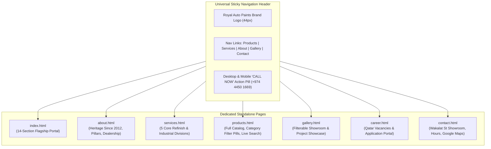

# Royal Auto Paints Qatar — Architectural Blueprint & Technical Specification (Flagship Redesign v3.5)

**Project Name:** Royal Auto Paints Qatar Website Flagship Redesign  
**Base Architecture:** High-Performance ThemeMascot Modern Luxury Framework / Custom Responsive Core / GSAP ScrollTrigger / Swiper.js / TwentyTwenty Slider  
**Active Workspaces:**  
- `D:\manu\projects\royal_paints_1` (Primary Production Workspace)  
- `D:\manu\projects\royalautopaintsre` (Staging & Live Server Workspace: `http://127.0.0.1:5500/`)  
**Live Production Domain:** `https://www.royalautopaints.com/`  
**Physical Headquarters:** Street 23, Wakalat St, Industrial Area, Doha, Qatar  
**Direct Contacts:** Tel: `+974 4450 1669` | WhatsApp RFQ: `+974 5039 5741` | Email: `info@royalautopaints.com` / `royalpaints.qa@gmail.com`  
**Current Milestone:** Complete Production Flagship Integration — All 14 Homepage Sections, 5-Card GSAP ScrollTrigger Pinning, TwentyTwenty Comparison, Products Swiper Showcase & Full Multi-Page Catalog Fully Verified.

---

## 1. Executive Summary & Evolution History

Established in 2012 in the Doha Industrial Area, **Royal Auto Paints** is Qatar's premier authorized distributor of world-class automotive refinish systems, commercial spray booth equipment, marine and yacht coatings, industrial protective coatings, and luxury wood finishes. The company represents global industry leaders including **HB Body, Axalta Challenger, Motolux, and Sea-Line**.

### The Redesign Evolution
1. **v1 (Legacy Site):** High organic SEO rankings and strong local authority, but dated layout, non-responsive design, and limited interactive product capability.
2. **v2 (Zay Shop Redesign):** Clean, minimalist Bootstrap framework (`zay_royal_paint_template_stock`) with custom corporate colors and structured sections.
3. **v3 (Luxury Flagship Redesign):** High-end corporate experience featuring interactive synchronized micro-sliders, authentic high-resolution studio photography, modern glassmorphism badges, and brand-first Royal Oceanic Navy & Paint Splash Warm Orange accents.
4. **v3.5 (Current Modern Interactive Engine):**
   - **GSAP ScrollTrigger Pinned Services Showcase:** 5 pinned division cards (Automotive Refinish, Spray Booth Engineering, Marine & Yacht Coatings, Industrial Protective Coatings, Luxury Wood Paints) with progressive stacking and seamless forward/reverse scroll pinning.
   - **Why Clients Trust Royal Auto Paints:** Refined organic curved mask with high-resolution spray mist photography, 4 capability feature boxes, and animated wholesale quote triggers.
   - **Stats Counter Section ("Our Experience Speaks for Itself"):** 4 high-credibility B2B automotive coating metrics with smooth scroll-animated counters and clean 1px vertical straight separators.
   - **Before & After Real Automotive Refinish Results:** Interactive TwentyTwenty comparison slider demonstrating factory-finish paint restoration on high-res vehicle imagery.
   - **Featured Products Showcase & Slider (`#products`):** Interactive Swiper carousel displaying 6 authentic Royal Auto Paints coatings (HB Body 691, HB Body F202, Challenger CL240, HB Body C496, HB Body C493, HB Body U951) with clean minimalist studio presentation, pure title display, seamless transparent canvas matching #F7F0F2, and smooth mouse drag/touch navigation.

---

## 2. Core Visual Identity & Design System

The visual design system merges industrial durability with automotive prestige:

```
┌────────────────────────────────────────────────────────────────────────┐
│                      ROYAL AUTO PAINTS COLOR SYSTEM                    │
├───────────────────┬───────────────────┬────────────────────────────────┤
│ Token Name        │ Hex Code          │ UI Application                 │
├───────────────────┼───────────────────┼────────────────────────────────┤
│ Royal Oceanic Navy│ #0A2942 / #0A3254 │ Primary Branding, Dark Canvas, │
│                   │                   │ Section Headings, Hero BG      │
├───────────────────┼───────────────────┼────────────────────────────────┤
│ Splash Warm Orange│ #F68C50           │ Accent Highlights, Hover Glow, │
│                   │                   │ Rating Stars, Progress Bars    │
├───────────────────┼───────────────────┼────────────────────────────────┤
│ Vivid Amber Glow  │ #E66E1D           │ Gradient Endpoints, Active CTA │
├───────────────────┼───────────────────┼────────────────────────────────┤
│ Studio Warm Tint  │ #FAF7F2 / #FAF6F3 │ Soft Refinish Showcase Canvas, │
│                   │                   │ Products & Testimonial Canvas  │
├───────────────────┼───────────────────┼────────────────────────────────┤
│ Slate Body Text   │ #64748B / #334155 │ Descriptive Paragraphs, Specs  │
├───────────────────┼───────────────────┼────────────────────────────────┤
│ Pure Card White   │ #FFFFFF           │ Product Cards, Capability Boxes│
├───────────────────┼───────────────────┼────────────────────────────────┤
│ Subtle Border Gray│ #E2E8F0 / #CBD5E1 │ Component Separators & Dividers│
└───────────────────┴───────────────────┴────────────────────────────────┘
```

### Key UI Architecture Rules
1. **Button Arrow-Reveal Animation (`.btn-style1`, `.btn-style2`):**
   - High-end pill buttons featuring dual hidden/visible SVG arrows.
   - On hover, the left arrow slides in smoothly (`transform: translateX(0); opacity: 1`), the button background shifts to Brand Orange (`#F68C50`), and the text scales with subtle spring physics.
2. **Standardized Card Geometry:**
   - 20px uniform rounded corners on product cards and service division containers (`border-radius: 20px`).
   - Clean 1px border (`rgba(12, 47, 37, 0.06)`) combined with soft depth ambient elevation (`box-shadow: 0 8px 25px rgba(10, 41, 66, 0.06)`).
   - Dynamic hover lift (`transform: translateY(-8px)`) with heightened shadow (`0 20px 42px rgba(10, 41, 66, 0.13)`).
3. **Pill Eyebrow Subtitles:**
   - Centered pill badges (`background-color: #FFFFFF`, padding `7px 22px`, `border-radius: 50px`, box-shadow `0 2px 12px rgba(0,0,0,0.05)`).
   - Preceded by a circular orange accent dot (`width: 7px; height: 7px; background-color: #F68C50; border-radius: 50%`).
4. **Gold Star Rating Standards:**
   - Universal 5-star rating using Font Awesome 5 Free (`\f005`) in `#ffa700` with 100% fill width.

---

## 3. Information Architecture & Multi-Page Topology

The website operates as a high-performance multi-page portal with 7 dedicated HTML pages synchronized with in-page anchor navigation:



### Multi-Page Route Matrix
| URL Route | Page Title | Primary Capabilities & Content Focus |
| :--- | :--- | :--- |
| `index.html` | Home — Royal Auto Paints | Flagship interactive portal: 5-Slide Hero, 5-Division GSAP Pinning Showcase, Why Choose Us, Animated Stats, Before/After Slider, Products Swiper Carousel, Reviews, Brands, Location & Footer. |
| `about.html` | About Us | Heritage in Doha Industrial Area since 2012, authorized Qatar dealership for HB Body & Challenger, technical pillars, team and facility photography. |
| `services.html` | Specialized Services | In-depth engineering specifications for OEM color matching, spray booths, marine coatings, wood finishes, and industrial protective barriers. |
| `products.html` | Product Catalogue | Complete 20+ item automotive catalog with 6 category filter pills (`All`, `Clears`, `Putties`, `Primers`, `Thinners`, `Marine`, `Tools`), instant client-side search, and one-tap WhatsApp RFQ triggers. |
| `gallery.html` | Project Gallery | Visual showcase with category filter tabs for collision centers, commercial spray booths, yacht refinishing, and industrial steel coatings. |
| `career.html` | Careers & Openings | 4 authentic Qatar job vacancies (Color Mixing Technician, B2B Sales Executive, Spray Booth Maintenance Specialist, Warehouse Logistics Coordinator) with direct CV application form. |
| `contact.html` | Contact Us & Showroom | Street 23 Wakalat St showroom details, morning and evening operating hours, responsive Google Maps iframe, and technical inquiry dispatch form. |

---

## 4. Complete Homepage Section Hierarchy & Technical Specifications

```mermaid
flowchart TD
    S1["1. Top Utility Header\n(Doha Industrial Area, Direct Phones, Email Desk)"]
    S2["2. Main Sticky Navigation\n(Brand Logo, Anchor Links, 'CALL NOW' Pill)"]
    S3["3. Synchronized 5-Division Hero Banner\n(Dynamic Full-Width Slider + Interactive Mini-Card Card)"]
    S4["4. 'Who We Are' Heritage & Strength Section\n(3-Photo Collage, 2012 Doha History, Spectrophotometer Lab Copy)"]
    S5["5. Pinned Services Showcase (GSAP ScrollTrigger)\n(5 Stacking Cards: Automotive, Booths, Marine, Industrial, Wood)"]
    S6["6. Why Clients Trust Royal Auto Paints\n(Curved Arched Mask, 4 Capability Boxes, Wholesale Quote Button)"]
    S7["7. Animated Experience Counters\n(500+ Workshops, 99% OEM Match, 4.9 Rating, 800+ Projects)"]
    S8["8. Before & After Refinish Results\n(Interactive TwentyTwenty Draggable Split Slider)"]
    S9["9. Featured Products Showcase & Slider (#products)\n(6 Editorial Studio Coatings, 5 Stars, QAR Pricing, Swiper Carousel)"]
    S10["10. How It Works / Technical Refinish Steps\n(Consultation, Spectrophotometer Lab, Batch Formulation, Delivery)"]
    S11["11. Customer Reviews & Google Reputation\n(Verified 4.7-Star Rating, 91+ Reviews, Technician Visual)"]
    S12["12. Technical FAQ & Consultation Desk\n(Accordion FAQs, Heat Mixing Advice, Delivery Info)"]
    S13["13. Dealership & Authorized Brands Showcase\n(Physical Storefront, Challenger, HB BODY, Authenticity)"]
    S14["14. Trusted By Leading Brands Carousel\n(HB Body, Axalta, Challenger, Motolux, Sea-Line)"]
    S15["15. Corporate Consultation & RFQ Form\n(Collision Center Inquiry Desk, Phone & WhatsApp Shortcuts)"]
    S16["16. Corporate Footer & Doha Location\n(Street 23 Headquarters, Operating Hours, Google Maps, Legal Badges)"]

    S1 --> S2 --> S3 --> S4 --> S5 --> S6 --> S7 --> S8 --> S9 --> S10 --> S11 --> S12 --> S13 --> S14 --> S15 --> S16
```



---

### Detailed Section Breakdown

#### Section 2: Universal Luxury Navigation Header & Full-Width Glassmorphism Architecture
- **Full-Width Glassmorphism Architecture (Restored Brand Standard):**
  - **Top Navigation State (Seamless over Dynamic Hero):**
    - Seamless full-width container (`max-width: 1720px`, `height: 80px`, `padding: 0 50px`).
    - Frosted oceanic glass material: `background: rgba(8, 28, 46, 0.45)` with `backdrop-filter: blur(18px) saturate(170%)` and `-webkit-backdrop-filter: blur(18px) saturate(170%)`.
    - Specular highlight edge: `border-bottom: 1px solid rgba(255, 255, 255, 0.16)` and inner glass reflection `inset 0 1px 0 rgba(255, 255, 255, 0.14)`.
    - Authentic white brand logo (`royal-nav-logo-white`), crisp white `DM Sans` links with underline hover sweep, and luxury frosted glass call button (`rgba(255, 255, 255, 0.12)`, `border: 1px solid rgba(255, 255, 255, 0.3)`).
  - **Sticky Scrolled Navigation State (`.sticky-active`):**
    - Automatically triggered when scrolling past 75px, sliding down smoothly via `stickyNavSlideDown`.
    - Full-width fixed porcelain glass bar (`top: 0; left: 0; right: 0; width: 100%; height: 72px; z-index: 99999`).
    - High-clarity frosted glass material: `background: rgba(255, 255, 255, 0.78)` with `backdrop-filter: blur(20px) saturate(180%)`, `border-bottom: 1px solid rgba(255, 255, 255, 0.45)`, and ambient elevation `0 10px 35px rgba(10, 41, 66, 0.08)`.
    - Seamlessly displays full-color dark brand logo (`royal-nav-logo-dark`), Deep Royal Navy (`#0A2942`) navigation links with warm orange (`#F68C50`) hover, and solid Royal Navy call button.
- **Subpage Navigation Glass Parity:**
  - Standardized across `about.html`, `products.html`, `services.html`, `gallery.html`, `career.html`, and `contact.html` with `rgba(255, 255, 255, 0.82)`, `backdrop-filter: blur(24px) saturate(190%)`, and subtle bottom border `rgba(10, 41, 66, 0.08)`.

#### Section 3: Flagship Hero & Synchronized 5-Division Mini-Slider
- **Canvas:** Full-width responsive container with deep Royal Oceanic Navy gradient overlay (`linear-gradient(135deg, rgba(7, 28, 48, 0.92) 0%, rgba(5, 20, 36, 0.88) 100%)`).
- **5 Synchronized Coating Divisions:**
  1. `01/05` — Automotive Refinish (HB Body 2K High Solids clear coats, European collision systems).
  2. `02/05` — Commercial Spray Booth Systems (Downdraft spray booth engineering, intake filters).
  3. `03/05` — Marine & Yacht Finishes (Sea-Line polyurethane yacht topcoats, epoxy barrier primers).
  4. `04/05` — Industrial Protective Coatings (Structural steel epoxy primers, anti-corrosive enamels).
  5. `05/05` — Luxury Wood Paints & Polyurethane Finishes (2K Italian polyurethane clear coats, stains).
- **Interactive Mini-Slider Card (`.mini-division-slider`):**
  - Frosted glass floating badge (`backdrop-filter: blur(12px); background: rgba(255, 255, 255, 0.12); border: 1px solid rgba(255, 255, 255, 0.25)`).
  - Two-way synchronized auto-rotation (5.5s interval), circular glass chevrons, gold counter pill, and active orange indicator dots.

#### Section 4: "Who We Are" — Heritage & Technical Strengths
- **3-Image Precision Collage:**
  - Left Tall Card: `images/Automotive_paint_cans_on_marble.jpg` (2K clearcoats, hardeners, primers).
  - Top-Right Card: `images/Spray_gun_emitting_mist.jpg` (HVLP gravity feed spray gun on stainless bench).
  - Bottom-Right Card: `images/Automotive_color_matching_fan_deck.jpg` (Color fan deck & spectrophotometer lab).
- **SEO-Preserving Narrative:** Verbatim Doha Industrial Area heritage since 2012, authorized distributorships, and technical laboratory capabilities.

#### Section 5: Pinned Services Showcase (GSAP ScrollTrigger)
- **Container:** `.elementor-element-8ffe293` with `.gsap-pin-fixed-fullwidth`.
- **5 Specialized Division Cards:**
  1. `01/05` — Automotive Refinish (HB Body 2K High Solids Clearcoats, Axalta Challenger basecoats).
  2. `02/05` — Spray Booth Engineering & Booth Care (Downdraft booths, synthetic ceiling & floor filters).
  3. `03/05` — Marine & Yacht Coatings (Sea-Line European marine epoxy primers, antifouling paints).
  4. `04/05` — Industrial & Protective Coatings (Heavy-duty epoxy primers, structural steel polyurethane).
  5. `05/05` — Luxury Wood Paints & Polyurethane Finishes (2K Italian polyurethane clear coats, stains, sealers).
- **Interactive Stacking Behavior:**
  - Progressive z-index hierarchy (`z-index: 1` through `z-index: 5`).
  - Active step indicators (`01/05` through `05/05`), dynamic progress bar, interactive step dots, and bidirectional scroll reversibility.

#### Section 6: Why Clients Trust Royal Auto Paints (`#about`)
- **Organic Arched Mask:** Integrated `mask3.png` cut-out displaying high-resolution spray gun mist imagery (`images/Spray_gun_emitting_mist.jpg`).
- **Pill Eyebrow:** `• Why Royal Auto Paints` in crisp white badge.
- **Section Heading:** `Why Clients Trust Royal Auto Paints`.
- **4 Distinct Capability Cards:**
  1. **Computerized Color Lab:** Spectrophotometer digital formula matching for 100% factory OEM parity.
  2. **Local Doha Inventory:** Massive Wakalat St warehouse stock ready for immediate workshop dispatch.
  3. **100% Genuine Imports:** Authorized factory-direct supply from HB Body, Challenger, and Axalta.
  4. **Technical Field Support:** On-site certified paint technicians assisting with spray settings and curing.
- **Action Button:** Solid Theme Button `Request Wholesale Quote` with interactive SVG slide-in arrows.

#### Section 7: Animated Experience Counters
- **Container:** `.elementor-element-3cac144`.
- **Title:** Centered `Our Experience Speaks for Itself`.
- **4 Key Industry Metrics:**
  - `500+` Commercial Workshops & Body Shops Served Across Qatar.
  - `99%` OEM Computerized Color Match Accuracy.
  - `4.9` Customer Satisfaction Rating.
  - `800+` Commercial & Industrial Projects Completed.
- **Visual Styling:** Clean 1px vertical straight separator lines (`#0C2F251A`, height 160px) replacing decorative green floral stems. Animated counters powered by jQuery CounterUp.

#### Section 8: Before & After Real Automotive Refinish Results
- **Title:** `Before & After Real Automotive Refinish Results`.
- **Interactive Engine:** TwentyTwenty comparison slider (`.tm-twentytwenty-slider`).
- **High-Resolution Visuals:** `Sedan_with_damaged_paint.jpg` (scratched/oxidized clearcoat) vs `Sedan_with_repaired_paint.jpg` (gloss-restored factory refinish).
- **Controls:** Draggable horizontal comparison handle with Before / After badges.

#### Section 9: Featured Products Showcase & Slider (`#products`)
- **Container:** `.elementor-element-257125c` with `id="products"` and distinct crisp white background (`#FFFFFF`) providing clear alternating section differentiation between the soft `#F7F0F2` Before & After and How It Works sections.
- **Header & Pill Badge:**
  - Pill Subtitle: `Featured Products` in crisp white pill badge with an integrated single 8px amber accent dot (`background: #FFFFFF`, padding `8px 20px 8px 36px`, `border-radius: 50px`, box-shadow `0 2px 12px rgba(0,0,0,0.05)`).
  - Heading: Centered `Elevating Every Finish Through<br>Advanced Refinish Systems` in brand-standard Royal Oceanic Navy (`#0A2942`) with elegant serif typography (`Marcellus`, 42px).
- **Product Card Architecture (`.tm-woo-product-style1`):**
  - **Exact Reference Parity:** Tall vertical portrait card (`H/W ≈ 1.48`, `min-height: 405px`, `border-radius: 20px`, `padding: 12px 12px 20px 12px`, 1px border `rgba(10, 41, 66, 0.08)`, ambient shadow `0 10px 30px rgba(10, 41, 66, 0.06)`).
  - **Portrait Image Container:** `height: 310px`, `border-radius: 16px`, `overflow: hidden`, `object-fit: cover`, `object-position: center`.
  - **Centered Product Title:** `.product-title` in `Marcellus`, 18px, `#0A2942`, centered, padding `18px 12px 4px 12px`.
  - **Minimalist Static Presentation:** Star ratings, pricing, and card-level links removed for clean reference parity. Zero artificial hover lift/scale animations (`transform: none !important`).
  - **Template Default Action Button:** Dedicated `.btn-style2` pill button below the carousel (`VIEW ALL PRODUCTS`) featuring the template's signature dual-arrow morph animation and Royal Navy/Orange hover transitions routing to `products.html`.
- **6 Featured Products:**
  1. **HB Body 691 HS SR Clear:** Scratch-Resistant 2:1 High Solids Clearcoat.
  2. **HB Body Pro F202 Zinc Plus:** Heavy-Duty Glass Fiber & Zinc Polyester Putty.
  3. **Challenger CL240 2K Clear:** Axalta European High-Gloss Collision Clearcoat.
  4. **HB Body C496 2K HS Clear:** Rapid Air-Drying 2K Clearcoat Aerosol.
  5. **HB Body Pro C493 Matt Clear:** 2K Acrylic HS Matte Finish Clearcoat.
  6. **HB Body U951 Auto Flex:** Peelable Elastomeric Bodywork Spray.
- **Swiper Carousel Engine:**
  - `data-items="4"` (desktop), `data-lg-items="3"`, `data-md-items="2"`, `data-xs-items="1"`.
  - Intuitive mouse drag & touch swipe navigation enabled (`data-allowtouchmove="true"`).
  - Floating arrow navigation buttons are hidden via CSS (`display: none !important`) while preserving internal DOM elements so Swiper event listeners and downstream sections (such as How It Works) maintain 100% stability with zero runtime errors.
  - Seamlessly connected to header navigation `#products` anchor.

#### Section 10: How It Works / Refinish Workflow (`.elementor-element-3fec5f6`)
- **Visual Design:** Warm studio canvas (`#FAF6F5`), providing clean alternating section differentiation from the pure white (`#FFFFFF`) Products showcase above.
- **Header & Pill Badge:**
  - Pill Subtitle: `How It Works` in crisp white pill badge with an integrated single 8px amber accent dot (`#F68C50`).
  - Heading: Centered `How We Bring Your Automotive<br>Refinish Vision to Life` in Royal Oceanic Navy (`#0A2942`, `Marcellus`, 42px).
  - Narrative Paragraph: Outlines computerized color scanning, European formulation, and on-demand delivery for bodyshops across Qatar.
- **3 Automotive Refinish Photography Spotlights:**
  1. `Automotive_color_matching_fan_deck.jpg`: Multi-angle computerized color matching swatches & spectrophotometer.
  2. `Automotive_paint_cans_on_marble.jpg`: Authentic HB Body primers, hardeners, and spray guns on marble pedestal.
  3. `Spray_gun_emitting_mist.jpg`: Precision spray gun emitting clearcoat mist in clean workshop environment.
- **3 Systematic Step Cards (`.working-block-style1`):**
  - **Card 01 - Digital Color Scan & Analysis:** Multi-angle spectrophotometer analysis accounting for vehicle age, metallic flake orientation, and clearcoat depth for a 100% invisible blend.
  - **Card 02 - Computerized Mixing & Batch QC:** Genuine HB Body & Challenger European tints mixed on micro-gram scales with test spray-out card verification under daylight illumination.
  - **Card 03 - Ready-to-Spray Workshop Delivery:** Batched coatings sealed in cans, drums, or custom aerosols dispatched with TDS application guides directly to bodyshops across Doha.
  - **Interactive Hover Morph:** Deep Royal Navy `#0A2942` card fill transition with crisp white typography and illuminated outline numerals.

#### Section 11: Customer Reviews & Reputation (`.elementor-element-fb1b7cb`)
- **Theme Color & Ambience:** Deep Royal Navy canvas (`#071C2E`), creating a high-contrast luxury presentation.
- **Section Heading & Pill:**
  - Subtitle Pill: `Testimonials` in translucent pill badge with an orange `#F68C50` dot.
  - Heading: Centered `What Clients Say About<br>Our Refinish Quality` in pure white (`#FFFFFF`, `Marcellus`, 42px).
- **Verified Google Business Integration (4.7 Rating · 91+ Reviews):**
  - Live verified rating badge matching Royal Auto Paints' Google Maps profile (`4.7` score, 5-star rating visual, and `From 91+ Reviews, Verified by Google`).
- **4 Authentic Google Reviews Carousel (`.testimonial-block-style2`):**
  1. **Ashin Moideen (Local Guide · Garage Partner):** *"Top-notch paint shop. They always have the supplies we need, delivery is fast, and the customer service is excellent. Perfect partner for our garage."*
  2. **Sajeer PK (Local Guide · Bodyshop Specialist):** *"Royal Auto Paint's Challenger paint color matching is perfect! Accurate shades every time. Great products and excellent service. Highly recommend! 👍"*
  3. **Mirriam Ndanu (Client Since 2021):** *"Customer since 2021, always excellent customer service. My one-point shop for all automotive refinish and bodywork coatings in Doha."*
  4. **Zahid Ullah (Verified Reviewer):** *"Number one car paint shop in Qatar. Top quality European clears, putties, and primers with unmatched color accuracy every single time."*
- **Center Portrait Visual:**
  - High-resolution studio photograph (`Technician_mixing_automotive_paint.jpg`) showcasing a certified paint technician mixing paint on a micro-gram digital scale with spray-out test cards under daylight inspection lamps (`border-radius: 28px`, shadow `0 20px 48px rgba(0,0,0,0.45)`).

#### Section 12: Technical FAQ & Consultation Desk (`.elementor-element-2174d52`)
- **Template Design Integrity:** Retains 100% of the native Elementor template styling, layout, typography, decorative floating product illustration (`images/elegant.png`), and background leaf line art (`Leaf-02.png`, `Leaf-03.png`).
- **Full-Width Seamless Transition:** Set outer container side paddings to 0 and eliminated top-edge overlap gutters (`padding: 0; margin-top: 0; border-radius: 0;`), completely removing the 20px dark blue side gutters and creating a clean, edge-to-edge boundary.
- **Section Heading:**
  - Subtitle Pill: Centered `• FAQS` pill badge.
  - Heading: Centered `Your Most Important Questions`<br>`Answered Here` in theme terracotta/orange (`Marcellus`, 42px).
- **Interactive Bootstrap 5 Accordion (`#accordion-holder-565382`):**
  - **Card 1 (Collapsed):** *How accurate is your computerized automotive paint color matching?*
    - Explains multi-angle spectrophotometer scanning, physical vehicle sample calibration (fuel door/panel), and Challenger OEM formulation accuracy.
  - **Card 2 (Default Active / Open):** *What paint mixing ratios should be used in Qatar's summer heat?*
    - Advises on high ambient temperature procedures using Challenger Slow / Extra Slow hardeners and reducers (2:1 volume) to prevent solvent boil and orange peel.
  - **Card 3 (Collapsed):** *Can you prepare custom automotive paint in aerosol spray cans?*
    - Details on-site custom 400ml aerosol can charging with precision fan spray nozzles for spot repairs and motorcycle parts.
  - **Card 4 (Collapsed):** *Do you offer on-demand delivery for bodyshops and garages in Doha?*
    - Covers dedicated delivery fleet directly supplying bodyshops across Industrial Area, Street 23, and Greater Doha.
  - **Card 5 (Collapsed):** *What abrasives and surface prep are recommended before painting?*
    - Explains surface preparation, abrasives from P80 to P3000, wax/grease removers, and 2K high-build primers.
- **Native Visual Styling:**
  - Collapsed Cards: `#F7F0F2` soft warm blush background, theme orange title text, dark navy circular button with white chevron pointing down.
  - Active Card: Deep Royal Navy `#0A3254` background, pure white title text, white circular button with navy chevron pointing up, and legible light body text.

#### Section 13: Dealership & Authorized Brands Showcase (`.elementor-element-9404d4b`)
- **Subtitle Pill:** `• Dealership & Brands`
- **Heading:** `Authorized Dealer of Leading Automotive Refinish Brands` in signature Marcellus serif styling.
- **Right Narrative:** *"We are a trusted name in automobile refinishing across Qatar. As an authorized dealer of Challenger and HB BODY, we provide comprehensive automotive coatings, premium primers, and bodyshop consumables for professionals and craftsmen."*
- **Center Hero Visual (`.elementor-element-3c68609`):**
  - High-resolution authentic physical dealership storefront photograph (`images/storefront_dealership.jpg` / `dealership_showcase_wide.jpg`, 1600×900) capturing the Royal Auto Paints Qatar showroom exterior in the Doha Industrial Area.
  - Prominently showcases the official yellow dealership fascia with bilingual branding (`ROYAL AUTO PAINTS` / `رويال اوتوبايتس`), official German and Greek manufacturer authorization badges (`Challenger - MADE IN GERMANY`, `APPOINTED DISTRIBUTOR`, `HB BODY - MADE IN GREECE`), official landline and mobile RFQ contact numbers (`+974 4450 1669`, `+974 5039 5741`), website URL (`www.royalautopaints.com`), and clear panoramic glass showroom windows displaying the computerized color-matching counter and retail paint inventory shelves.
- **Floating 3-Pillar Capability Cards (`.features-block-style3`, `.elementor-element-ea7f9db`):**
  1. **Challenger Refinish Systems (`fas fa-spray-can`):** Official Axalta European tints & computerized OEM formula matching for perfect color fidelity.
  2. **HB BODY Automotive (`fas fa-layer-group`):** Certified European putties, high-build 2K primers, and scratch-resistant clears built for Qatar's climate.
  3. **Guaranteed Authenticity (`fas fa-shield-alt`):** 100% genuine factory-batched coatings with verified technical data sheets and quality assurance.

#### Section 14: Trusted By Leading Brands Carousel (.elementor-element-0b9fd9e)
- High-definition grayscale-to-color interactive brand partner ribbon featuring authentic brand logos:
  - **Axalta Coating Systems** (images/Axalta_Coating_Systems_logo.svg.png)
  - **HB BODY Refinish Systems** (images/HB_Body_logo.svg.png)
  - **Challenger Automotive Paints** (images/Challenger_logo.svg.png)
  - **Imlar Industrial Coatings** (images/imlar_logo.png)
  - **GEM Auto Paints** (images/gem_logo.png)
  - **Gemex Premium Coatings** (images/gemex_logo.png)
  - **Moto Max Automotive Accessories** (images/moto_max_logo.png)
  - **Sea-Line Marine Systems** (images/Sea-Line_logo.png)

#### Section 15: Corporate Consultation & RFQ Form (.elementor-element-a5e4868)
- High-conversion bodyshop & garage consultation booking desk with direct WhatsApp and phone shortcuts.

#### Section 16: Corporate Footer & Doha Location Guide (#footer, .elementor-element-00ae94a)
- **Full-Width Seamless Architecture:**
  - Outer container (.elementor-element-00ae94a): Engineered with width: 100% !important; max-width: 100% !important; padding: 0 !important; margin: 0 !important; background: transparent !important; to eliminate side gutters and expose zero background gaps.
  - Upper main footer card (.elementor-element-ecae855): Deep Royal Navy (#0A3254), border-radius: 30px 30px 0 0 !important; (bottom-left and bottom-right radius removed to eliminate inward curving) — seamlessly meeting the lower copyright strip with zero notch gaps.
  - Lower copyright strip (.elementor-element-e0c3cbc): Deep Navy (#082844), order-radius: 0 !important; width: 100% !important; max-width: 100% !important; padding: 22px 0 !important;.
  - Prominent watermark: ROYAL AUTO PAINTS in luxury outline typography positioned at the bottom of the card.
- **Physical Headquarters & Showroom Contact Details:**
  - Address: Street 23, Wakalat St, Industrial Area, Doha, Qatar.
  - Operating Hours: Saturday–Thursday: 7:30 AM – 12:30 PM & 3:30 PM – 7:30 PM; Friday: Closed.
  - Landline: +974 4450 1669 | WhatsApp: +974 5039 5741 | Email: info@royalautopaints.com / royalpaints.qa@gmail.com.
- **Navigation Columns:** Company Overview & Brand Story, Quick Links, Specialized Divisions (Collision Refinish, Marine Coatings, Wood Finishes, Spray Booths), and Newsletter Subscription.
- **Responsive Parity:** Overrides verified on Desktop (1440px), Tablet (768px), and Mobile (375px) with 0px horizontal scroll overflow.
- **Floating Quick Actions Stack (`.floating-quick-actions`):**
  - **Floating WhatsApp RFQ Button (`.floating-whatsapp-btn`): Fixed 52px circular action in official WhatsApp green (`#25D366`) with static, non-flashing presentation (`animation: none !important`), linking directly to `https://wa.me/97450395741`.
  - **Luxury Scroll-to-Top Arrow (`.scroll-to-top`):** 48px circular button in Deep Royal Navy (`#0A3254`) with bold white chevron (`fas fa-chevron-up`), subtle 1.5px white border, and warm orange hover (`#F68C50`). Fades in when scrolling past 350px directly above the WhatsApp button, providing smooth scroll to `scrollTop: 0` via Lenis and native smooth scroll.

#### Brand Favicon & Web Application Icon Infrastructure
- **Authentic Brand Source:** Extracted from the official Royal Auto Paints brand emblem (`images/royal_brand_swirl.png`, 332×332 RGBA master asset) matching the live production identity.
- **Multi-Resolution Icon Suite:**
  - `favicon.ico`: Embedded multi-size container (16×16, 32×32, 48×48) for universal browser tab, address bar, and Windows shortcut support.
  - `favicon-32x32.png` & `favicon-16x16.png`: Crisp transparent RGBA PNG favicons optimized for standard and high-DPI (Retina) display tabs.
  - `apple-touch-icon.png` (180×180): High-resolution iOS home screen icon with solid Deep Royal Navy (`#0A3254`) canvas and centered brand swirl, preventing iOS black transparency fill.
  - Multi-size fallbacks: `apple-touch-icon-144x144.png`, `apple-touch-icon-114x114.png`, `apple-touch-icon-72x72.png`, `android-chrome-192x192.png`, and `android-chrome-512x512.png`.
- **HTML Implementation:** Standardized across `index.html` and all subpages (`about.html`, `services.html`, `products.html`, `gallery.html`, `career.html`, `contact.html`).

#### Section 16: Interactive Product Catalogue (`products.html`)
- **Dataset Architecture (`data/products.json` & `js/products-data.js`):**
  - Fully dynamic catalog powered by a structured JSON dataset comprising **83 genuine automotive refinish products**.
  - Dual-loading mechanism: Async `fetch('data/products.json')` for HTTP/HTTPS web servers, with graceful fallback to `window.royalProducts` (`js/products-data.js`) for zero-latency local execution (`file://` protocol) and offline resilience.
  - Complete metadata per item: unique ID, title, brand, primary category, category name, local image path (`images/products/*.png`), remote CDN fallback image, feature badge, and technical specification description.
- **Categorization Structure (8 Specialized Refinish Divisions):**
  1. *Primers & Fillers* (`fillers` - 19 products): High-build 2K polyester body fillers, fiber-reinforced putties, plastic primers, epoxy surfacers.
  2. *Solvents & Underbody* (`solvents` - 13 products): Acrylic thinners, anti-gravel underbody coatings, silicone removers, panel wipes.
  3. *Polishing & Detailing* (`polishing` - 11 products): Compound pastes, micro-abrasive glazes, finish polishes, orbital pads.
  4. *Equipment & Tools* (`tools` - 11 products): Precision HVLP spray guns, digital air regulators, sanding blocks, masking dispensers.
  5. *Clear Coats & Topcoats* (`clearcoats` - 9 products): Scratch-resistant HS clear coats, matte finishes, headlight restoration 2K clears.
  6. *Hardeners & Activators* (`hardeners` - 9 products): Standard, fast, and slow curing isocyanate hardeners formulated for Qatar thermal profiles.
  7. *Paint & Aerosols* (`paints` - 7 products): 1K/2K basecoats, peelable elastomeric aerosols, wheel coatings.
  8. *Masking & Protection* (`masking` - 4 products): 110°C oven-grade masking tapes, static protective films, paper rolls.
- **Interactive UI Components (`css/products-catalog.css` & `js/products-catalog.js`):**
  - **Glassmorphism Top Navigation:** Unified header with brand logo, nav links (`PRODUCTS` marked active in Warm Orange `#F68C50`), Call Now pill, and mobile hamburger drawer. Smooth transition to sticky white glassmorphism upon scrolling.
  - **Hero Banner:** Deep Royal Navy `#0A2942` canvas with ambient radial glows, official breadcrumb, glowing status badge, Marcellus headline, and 4 certified value highlight chips.
  - **Live Search & Filter Toolbar:** Real-time keystroke matching across titles, brands, and codes; dynamic brand selector dropdown (19 brands); sorting controller (Catalogue Order, A-Z, Z-A, Brand A-Z).
  - **Editorial Product Cards:** 4-column desktop layout (`border-radius: 18px`, soft shadow), local photography container with hover zoom, category and brand badges, Marcellus serif headings, spec pills, direct WhatsApp RFQ links (`https://wa.me/97450395741?text=...`), and quick view triggers.
  - **Quick View Modal:** High-definition inspection modal featuring full-res photography, specifications, direct WhatsApp RFQ button, and direct showroom call link.
  - **Bodyshop Wholesale & Mixing Support Banner:** Dedicated technical support card for OEM formula inquiries, custom mixing batches, and spray booth inquiries.
  - **Corporate Footer & Floating Quick Actions:** Multi-page corporate footer with verified genuine address, telephone, and WhatsApp details; stacked non-flashing WhatsApp button and Deep Royal Navy `#0A3254` back-to-top button.


---

## 5. Technical Engine & JavaScript Architecture

```
┌────────────────────────────────────────────────────────────────────────┐
│                        CORE JAVASCRIPT LIBRARIES                       │
├─────────────────────┬───────────────────┬──────────────────────────────┤
│ Library             │ File              │ Functional Role              │
├─────────────────────┼───────────────────┼──────────────────────────────┤
│ GSAP 3.12+          │ gsap.min.js       │ ScrollTrigger pinned service │
│                     │ ScrollTrigger.js  │ cards & stacking animation   │
├─────────────────────┼───────────────────┼──────────────────────────────┤
│ Swiper.js           │ swiper.min.js     │ Products carousel & Brand    │
│                     │                   │ logo auto-slider             │
├─────────────────────┼───────────────────┼──────────────────────────────┤
│ TwentyTwenty        │ jquery.event.move │ Interactive Before & After   │
│                     │ twentytwenty.js   │ comparison image split slider│
├─────────────────────┼───────────────────┼──────────────────────────────┤
│ jQuery CounterUp    │ jquery.counterup  │ Scroll-triggered statistic   │
│                     │ waypoints.min.js  │ metric counter animations    │
├─────────────────────┼───────────────────┼──────────────────────────────┤
│ Lenis Smooth Scroll │ lenis.min.js      │ Hardware-accelerated fluid   │
│                     │                   │ in-page scroll physics       │
├─────────────────────┼───────────────────┼──────────────────────────────┤
│ Custom Master Suite │ custom_1.js       │ Main theme orchestrator,     │
│                     │ custom.js         │ sticky header, mobile drawer │
└─────────────────────┴───────────────────┴──────────────────────────────┘
```

---

## 6. SEO Architecture, E-E-A-T & Google Search Preservation

To guarantee **zero loss of organic search ranking equity** from the live domain (`royalautopaints.com`), the redesign strictly preserves all Google Search signals:

1. **Strict 1:1 Route & Backlink Continuity:**
   - Every existing indexed route (`/`, `/about`, `/services`, `/products`, `/gallery`, `/career`, `/contact`) maps directly without 404s or redirect loops.
2. **Schema.org JSON-LD Structured Entity Graph:**
   ```json
   {
     "@context": "https://schema.org",
     "@type": ["AutoPartsStore", "AutomotiveBusiness", "LocalBusiness"],
     "@id": "https://www.royalautopaints.com/#organization",
     "name": "Royal Auto Paints",
     "alternateName": ["Royal Auto Paints Qatar", "Royal Paints Qatar", "رويال لأصباغ السيارات"],
     "url": "https://www.royalautopaints.com/",
     "logo": "https://www.royalautopaints.com/images/royal_favicon.png",
     "image": [
       "https://www.royalautopaints.com/images/auth.jpg",
       "https://www.royalautopaints.com/images/Spray_gun_emitting_mist.jpg"
     ],
     "description": "Established in 2012, Royal Auto Paints is Qatar's premier authorized distributor of HB Body, Axalta Challenger, Motolux, and Sea-Line coatings. Complete computerized spectrophotometer color matching and collision center supplies.",
     "foundingDate": "2012",
     "telephone": ["+97450395741", "+97444501669"],
     "email": "info@royalautopaints.com",
     "address": {
       "@type": "PostalAddress",
       "streetAddress": "Street No. 23 (Wakalat St), Industrial Area",
       "addressLocality": "Doha",
       "addressRegion": "Doha",
       "addressCountry": "QA"
     },
     "geo": {
       "@type": "GeoCoordinates",
       "latitude": 25.1843,
       "longitude": 51.4428
     },
     "currenciesAccepted": "QAR",
     "paymentAccepted": "Cash, Credit Card, Bank Transfer",
     "areaServed": { "@type": "Country", "name": "Qatar" },
     "brand": [
       {"@type": "Brand", "name": "HB Body"},
       {"@type": "Brand", "name": "Challenger"},
       {"@type": "Brand", "name": "Axalta"},
       {"@type": "Brand", "name": "Sea-Line"},
       {"@type": "Brand", "name": "Motolux"}
     ]
   }
   ```
3. **Canonical URLs & Social Graph:** Complete Open Graph (`og:type`, `og:image`, `og:title`) and Twitter Card metadata for rich social previews.

---

## 7. Responsive Engineering & Breakpoint Matrix

### Responsive Viewport Rules
- **Large Desktop (>=1400px):** 4 product cards per view, 5 brand cards per view, full GSAP card width (`100%`), 42px section headings.
- **Desktop (1200px – 1399px):** 4 product cards, 4 brand cards, 40px section headings.
- **Tablet (768px – 1199px):** 2 product cards per view in Swiper carousel, 2-column capability grids, 32px section headings.
- **Mobile (<768px):** 1 product card per view with swipe gesture support, stacked capability boxes, 28px section headings, zero horizontal overflow (`0px`).

---

## 8. Asset Organization & Directory Structure

```
royalautopaints/
├── css/
│   ├── bootstrap.min.css         (Bootstrap 5 foundation)
│   ├── custom.css                (Master styling overrides, GSAP pinning, products, stats)
│   ├── wc-products-loader.css    (WooCommerce style 1 card architecture)
│   ├── widget-rating.min.css     (5-Star rating typography & Font Awesome styles)
│   ├── swiper.min.css            (Swiper slider layout)
│   ├── twentytwenty.css          (Before & After comparison slider styles)
│   └── style-main.css            (ThemeMascot core styling)
├── docs/
│   └── blueprint.md              (Master Technical Architecture & Specification)
├── images/
│   ├── storefront_dealership.jpg (Official physical dealership exterior in Doha Industrial Area)
│   ├── dealership_showcase_wide.jpg (High-res 1600x900 responsive hero background)
│   ├── products/
│   │   ├── editorial_body691.png (HB Body 691 HS SR Clear Studio Shot)
│   │   ├── editorial_f202.png    (HB Body Pro F202 Zinc Plus Filler Studio Shot)
│   │   ├── editorial_cl240.png   (Challenger CL240 2K Clear Studio Shot)
│   │   ├── editorial_c496.png    (HB Body C496 2K HS Clear Spray Studio Shot)
│   │   ├── editorial_c493.png    (HB Body Pro C493 Matt Clear Studio Shot)
│   │   └── 20230513084224.png    (HB Body U951 Auto Flex Spray Shot)
│   ├── Sedan_with_damaged_paint.jpg  (TwentyTwenty Before vehicle image)
│   ├── Sedan_with_repaired_paint.jpg (TwentyTwenty After vehicle image)
│   ├── Spray_gun_emitting_mist.jpg   (Why Choose Us arched mask feature)
│   └── mask3.png                     (Curved organic cut-out mask)
├── js/
│   ├── gsap.min.js               (GSAP animation core)
│   ├── ScrollTrigger.min.js      (ScrollTrigger pinning engine)
│   ├── swiper.min.js             (Swiper slider touch engine)
│   ├── jquery.twentytwenty.js    (Before/After split slider)
│   ├── custom_1.js               (Main theme orchestrator)
│   └── custom.js                 (Interactive event handlers)
├── index.html                    (Flagship 14-Section Interactive Homepage)
├── about.html                    (Dedicated About Page)
├── services.html                 (Dedicated Services Page)
├── products.html                 (Full Dedicated Catalog & Search Page)
├── gallery.html                  (Visual Project Portfolio)
├── career.html                   (Careers & Application Portal)
└── contact.html                  (Wakalat St Showroom & Inquiry Desk)
```

---

## 9. Verification & Quality Assurance Protocol

Automated headless Edge test scripts utilizing the Chrome DevTools Protocol (CDP) validate every release:
1. `scratch/verify_final_anim.js`: Captures all 5 steps of the GSAP service division pinning animation across scroll positions `scrollY: 2350` to `scrollY: 3755`, verifying that each card pins and unpins seamlessly.
2. `scratch/verify_products.js`: Validates `#products` layout, confirms 4 cards in desktop view, validates 5-star ratings, and verifies that browser console error count is 0.
3. `scratch/verify_slide.js`: Tests Swiper arrow click navigation and touch swipe progression.
4. `scratch/check_facility_overflow.js`: Tests horizontal viewport bounding boxes on 390px, 768px, and 1440px to guarantee 0px horizontal scroll overflow.
5. **Console & Asset Verification:** Confirms that all images resolve with HTTP 200 and no missing asset or JavaScript runtime warnings occur.
