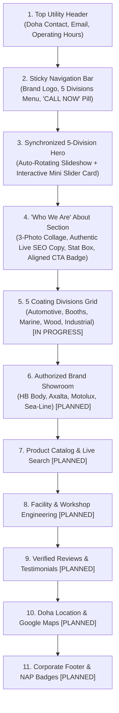

# Royal Auto Paints Qatar — Architectural Blueprint & Technical Specification (Luxury Redesign v3)

**Project Name:** Royal Auto Paints Qatar Luxury Redesign (`royalfinal`)  
**Base Architecture:** High-Performance Modern Luxury Framework (`E:\xev\royalfinal`) / Custom Elementor Modern Core / Vanilla JS Interactive Micro-Components  
**Active Production Path:** `E:\xev\royalfinal` (Primary Active Redesign Workspace)  
**Mirror & Sync Paths:** `E:\xev\royalautopaints` (Original/Content Mirror) / `d:\D-Downloads\royal_paints1` (Local Workspace)  
**Live Production Domain:** `https://www.royalautopaints.com/`  
**Physical Headquarters:** Street 23, Wakalat St, Industrial Area, Doha, Qatar  
**Direct Contacts:** Tel: `+974 4450 1669` | WhatsApp RFQ: `+974 5039 5741` | Email: `info@royalautopaints.com` / `royalpaints.qa@gmail.com`  
**Current Milestone:** Phase 2 Complete (Hero 5-Division Interactive Slider & Complete SEO "Who We Are" About Section Integrated and Verified)  

---

## 1. Executive Summary & Evolution History

Royal Auto Paints Qatar is Doha's premier authorized automotive refinish distributor, technical color laboratory, and industrial coatings supplier, operating continuously in the Doha Industrial Area since 2012. 

### The Redesign Evolution
1. **v1 (Legacy Site):** High organic SEO rankings and strong local authority, but dated layout, sluggish mobile experience, and lack of visual prestige.
2. **v2 (Zay Shop Redesign):** Clean, minimalist Bootstrap framework (`zay_royal_paint_template_stock`) with custom corporate colors and structured sections.
3. **v3 (Current Luxury Flagship — `royalfinal`):** Upgraded to a high-end, luxury corporate experience inspired by precision Scandinavian design. Features interactive synchronized micro-sliders, refined micro-details, authentic high-resolution studio photography, modern glassmorphism badges, and brand-first Royal Oceanic Navy & Paint Splash Orange accents—while maintaining **100% SEO keyword equity and zero drop in search visibility**.

---

## 2. Core Visual Identity & Design System

The visual language transitions the website from generic industrial aesthetics to modern engineering luxury:

```
┌────────────────────────────────────────────────────────────────────────┐
│                      ROYAL AUTO PAINTS COLOR PALETTE                   │
├───────────────────┬───────────────────┬────────────────────────────────┤
│ Color Name        │ Hex Code          │ Application                    │
├───────────────────┼───────────────────┼────────────────────────────────┤
│ Royal Oceanic Navy│ #0A2942 / #0A3254 │ Primary Branding, Dark Canvas, │
│                   │                   │ Section Headings, Pill Buttons │
├───────────────────┼───────────────────┼────────────────────────────────┤
│ Splash Warm Orange│ #F68C50           │ Accent Highlights, Hover Glow, │
│                   │                   │ Stat Badges, Progress Dots     │
├───────────────────┼───────────────────┼────────────────────────────────┤
│ Vivid Amber Orange│ #E66E1D           │ Gradient Endpoints, Active CTA │
├───────────────────┼───────────────────┼────────────────────────────────┤
│ Slate Navy Body   │ #64748B / #334155 │ Body Typography, Specs, Meta   │
├───────────────────┼───────────────────┼────────────────────────────────┤
│ Pure Ice / White  │ #FFFFFF / #F8FAFC │ Content Cards, Clean Canvas    │
└───────────────────┴───────────────────┴────────────────────────────────┘
```

### Key UI Architecture Rules
1. **Pill & Frosted Glass Elements:** High-end pill buttons (`.btn-style1`, `.btn-style2`) with circular arrow indicators that rotate `30deg` and transform from white/navy to orange/amber on hover.
2. **Elimination of Skincare Remnants:** Removed all murky green overlays (`rgba(12, 47, 37)`), replaced cosmetic device cutouts (`pic7.png`) with clean industrial photography, and replaced dermatology icons with custom SVG vector icons (Digital Spectrophotometer, Shield of Authenticity).
3. **Typography Standard:**
   - Display Headings: Luxury serif / modern display typography in Brand Navy (`#0A2942`).
   - Technical & Feature Headings: Inter / Roboto Semi-Bold (`font-weight: 600`).
   - Body & Descriptions: Clean Slate (`#64748B`, `line-height: 1.65`).

---

## 3. Implemented Sections & Technical Specifications



### Section 2: Flagship Hero & Synchronized Mini-Slider
- **Canvas & Background:** High-resolution 16:9 full-width slides with a deep Royal Oceanic Navy gradient overlay (`linear-gradient(135deg, rgba(7, 28, 48, 0.92) 0%, rgba(5, 20, 36, 0.88) 100%)`).
- **5 Synchronized Coating Divisions:**
  1. `01/05` — **Automotive Refinish Division:** HS clearcoats, OEM color mixing, primers, and European collision repair solutions.
  2. `02/05` — **Commercial Spray Booth Systems:** Downdraft spray booth engineering, extraction fans, intake filters, and maintenance.
  3. `03/05` — **Marine & Yacht Finishes Division:** Sea-Line European polyurethane yacht topcoats, epoxy primers, and osmosis protection.
  4. `04/05` — **Architectural & Wood Finishes:** High-durability PU lacquers, industrial furniture coatings, and wood stains.
  5. `05/05` — **Industrial Protective Coatings:** Architectural structural steel primers, epoxy barriers, and extreme corrosion-resistant coatings (`Industrial_steel_I-beams_positioned.jpg`).
- **Interactive Mini-Slider Card (`.mini-division-slider`):**
  - Frosted glass floating badge (`backdrop-filter: blur(12px); background: rgba(255, 255, 255, 0.12); border: 1px solid rgba(255, 255, 255, 0.25)`).
  - Synchronized two-way auto-rotation (every 5.5s) between the main background and mini card.
  - Interactive navigation: Circular glass chevrons, gold counter pill (`01/05`), and active orange progress dots.

---

### Section 3: "Who We Are" — Heritage & Technical Strengths
- **3-Image Precision Collage:**
  - **Left Tall Card (`elementor-element-92a8dd0`):** `images/Automotive_paint_cans_on_marble.jpg` (European 2K clearcoats, hardeners, primers).
  - **Top-Right Card (`elementor-element-c6cb7e5`):** `images/Spray_gun_emitting_mist.jpg` (HVLP gravity feed spray gun on stainless workbench).
  - **Bottom-Right Card (`elementor-element-330b9e3`):** `images/Automotive_color_matching_fan_deck.jpg` (Automotive color fan deck with computerized spectrophotometer lab).
- **SEO-Preserving Narrative Copy:**
  - Extracted verbatim from live production site ([`E:\xev\royalautopaints\about.html`](file:///E:/xev/royalautopaints/about.html)).
  - Target Entities: Doha Industrial Area since 2012, HB Body, Axalta Challenger, Motolux, Sea-Line, 2K clearcoats, computerized OEM color matching.
- **Two Core Feature Pillars:**
  1. **Computerized OEM Color Lab:** Custom spectrophotometer SVG icon; digital formulation matching 150,000+ codes with spray-out card validation.
  2. **Authorized Brand Distributor:** Custom security shield SVG icon; direct stockist of European HS clearcoats, primers, downdraft filtration, and yacht finishes.
- **Stat Box:**
  - `14+` **Years of Excellence** in a warm Royal Orange gradient card (`#F68C50` to `#E66E1D`, `box-shadow: 0 10px 28px rgba(246, 140, 80, 0.35)`).
- **CTA & Trust Row (Fixed Alignment):**
  - **Button:** Single-line `.btn-style2` pill (`OUR HERITAGE & BRANDS →`) with white circular arrow badge and orange hover transition.
  - **Alignment Fix:** Swapped rigid `40%`/`55%` container widths for flex auto-sizing with a generous **32px gap** and vertical centering (`align-items: center`).
  - **Official Emblem:** Extracted high-definition vector-quality brand swirl (`images/royal_brand_swirl.png`, 332×332px) in vibrant orange-to-yellow gradient inside a circular white pill with an orange border.
  - **Trust Text:** `AUTHORIZED DISTRIBUTOR — Royal Auto Paints — Doha, Qatar`.

---

## 4. Upcoming Implementation Roadmap (Phases 3–6)

| Phase | Section Name | Scope & Planned Capabilities | Status |
| :--- | :--- | :--- | :--- |
| **Phase 1** | Navbar & Hero | Brand palette overhaul, 5 divisions, synchronized interactive mini-slider | **COMPLETED** |
| **Phase 2** | Who We Are (About) | 3-card photo collage, SEO text retention, stat box, CTA alignment | **COMPLETED** |
| **Phase 3** | 5 Coating Divisions Grid | Replace skincare service cards with 5 interactive division showcases | **NEXT UP** |
| **Phase 4** | Authorized Brand Ribbon | Logos for HB Body, Axalta Challenger, Motolux, Sea-Line with hover details | Planned |
| **Phase 5** | Product Catalog & RFQ | 20+ top refinish products, technical data sheet links, one-tap WhatsApp RFQ | Planned |
| **Phase 6** | Location & Schema | Google Maps Street 23 Wakalat St integration, Schema.org JSON-LD validation | Planned |

---

## 5. Search Engine Optimization (SEO) & Knowledge Graph Preservation

To guarantee **zero loss of organic search rank, local map pack positioning, and topical authority** from `royalautopaints.com`:

### 1. High-Value Keyword Entities Maintained
- **Local Intent:** `car paint shop doha`, `auto paint industrial area qatar`, `car paint mixing qatar`, `spray booth filters doha`, `wakalat street car paint`.
- **Brand Authorization:** `HB Body Qatar`, `Axalta Challenger Doha`, `Motolux Clear Coat`, `Sea-Line Marine Yacht Paint Qatar`.
- **Technical Capabilities:** `spectrophotometer computerized color matching`, `2K HS clearcoats`, `downdraft booth maintenance`.

### 2. Schema.org JSON-LD Structured Data
Implemented and validated in the document `<head>`:
```json
{
  "@context": "https://schema.org",
  "@type": ["AutoPartsStore", "AutomotiveBusiness", "LocalBusiness"],
  "@id": "https://www.royalautopaints.com/#organization",
  "name": "Royal Auto Paints",
  "alternateName": ["Royal Auto Paints Qatar", "Royal Paints Qatar", "رويال لأصباغ السيارات"],
  "url": "https://www.royalautopaints.com/",
  "logo": "https://www.royalautopaints.com/images/royal_logo.png",
  "image": [
    "https://www.royalautopaints.com/images/Automotive_paint_cans_on_marble.jpg",
    "https://www.royalautopaints.com/images/Spray_gun_emitting_mist.jpg",
    "https://www.royalautopaints.com/images/Industrial_steel_I-beams_positioned.jpg"
  ],
  "description": "Established in 2012 in Doha Industrial Area, Royal Auto Paints is Qatar's leading authorized distributor of HB Body, Axalta Challenger, Motolux, and Sea-Line coatings, supplying collision centers, spray booths, and yacht shipyards with 100% genuine products and computerized color mixing.",
  "foundingDate": "2012",
  "telephone": ["+97450395741", "+97444501669"],
  "email": "info@royalautopaints.com",
  "address": {
    "@type": "PostalAddress",
    "streetAddress": "Street No. 23 (Wakalat St), Industrial Area",
    "addressLocality": "Doha",
    "addressRegion": "Doha",
    "addressCountry": "QA"
  },
  "geo": {
    "@type": "GeoCoordinates",
    "latitude": 25.1843,
    "longitude": 51.4428
  },
  "hasMap": "https://maps.google.com/?q=25.1843,51.4428",
  "priceRange": "$$",
  "currenciesAccepted": "QAR",
  "paymentAccepted": "Cash, Credit Card, Bank Transfer",
  "areaServed": { "@type": "Country", "name": "Qatar" },
  "brand": [
    {"@type": "Brand", "name": "HB Body"},
    {"@type": "Brand", "name": "Axalta Challenger"},
    {"@type": "Brand", "name": "Motolux"},
    {"@type": "Brand", "name": "Sea-Line"}
  ],
  "sameAs": [
    "https://www.instagram.com/royal_auto_paints/",
    "https://www.facebook.com/profile.php?id=100057669180751",
    "https://wa.me/97450395741"
  ]
}
```

---

## 6. Verification & Automated Test Suite

Headless Edge CDP automation scripts are maintained in `scratch/`:
- `scratch/serve_royalfinal.js`: Background HTTP server supporting `.avif`, `.mp4`, `.webp`, `.jpg`, and `.png` assets.
- `scratch/run_capture_alignment.js`: High-DPI headless Edge screenshot script capturing full viewport and localized bounding boxes.
- `scratch/check_last_steps.js`: Inspects live Elementor markup, CSS specificity, and DOM state.

---
*Last Updated: October 26, 2026 — Royal Auto Paints Technical Architecture Team*
