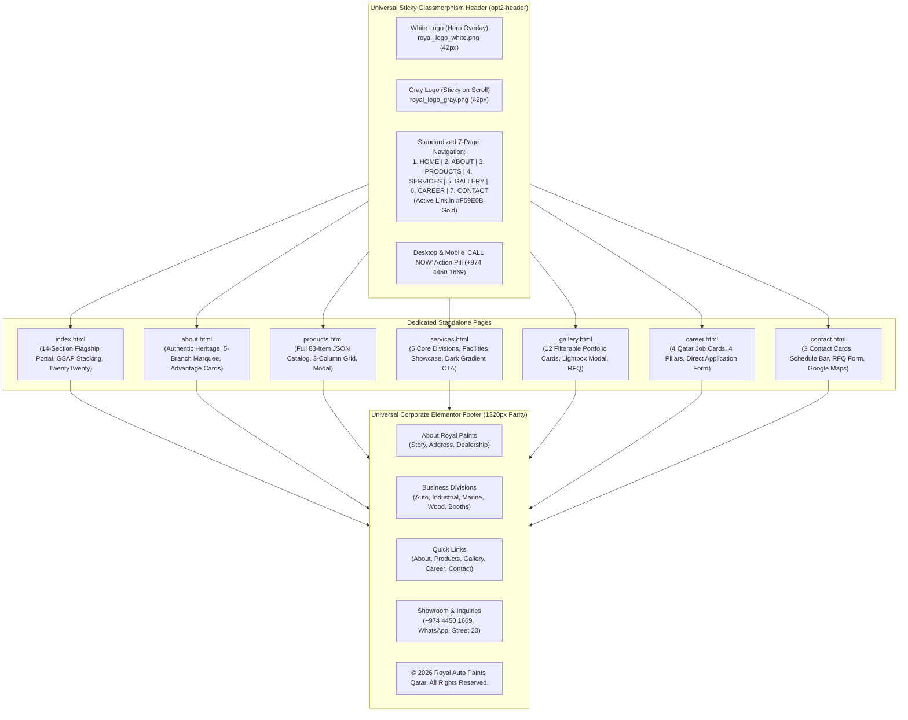

# Royal Auto Paints Qatar — Architectural Blueprint & Technical Specification (Flagship Redesign v6.0)

**Project Name:** Royal Auto Paints Qatar Website Flagship Redesign  
**Base Architecture:** High-Performance ThemeMascot Modern Luxury Framework / Custom Responsive Core / GSAP 3 ScrollTrigger & SplitText / Swiper.js / TwentyTwenty Slider / Standalone JSON-Driven Catalog Engine / Pure CSS Infinite Marquee Engine  
**Active Workspaces:** `E:\xev\royalfinal` (Primary Serving Workspace: `http://localhost:3000/`) & `E:\xev\royalautopaints` (Staging Workspace: `http://127.0.0.1:5500/`)  
**Live Production Domain:** `https://www.royalautopaints.com/`  
**Physical Headquarters:** Street 23, Wakalat St, Industrial Area, Doha, Qatar  
**Direct Contacts:** Tel: `+974 4450 1669` | WhatsApp RFQ: `+974 5039 5741` | Email: `info@royalautopaints.com` / `royalpaints.qa@gmail.com`  
**Current Milestone:** Complete Enterprise Production Architecture v6.0 — Full 7-Page Design System Parity across `index.html`, `about.html`, `products.html`, `services.html`, `gallery.html`, `career.html`, and `contact.html`; Unified Luxore Sticky Navigation with Gold `#F59E0B` Active Indicators; Split-Text Character Typography Animation Engine with Immediate On-Load Hero Execution; Official 5-Branch Commercial Logos Marquee on Luxury `#1c2533` Navy Slate Cards; Ground-Up Redesign of Gallery, Career, and Contact Pages; and 100% Elementor Corporate Footer Parity.

---

## 1. Executive Summary & Evolution History

Established in 2012 in the Doha Industrial Area, **Royal Auto Paints (Al-Haram Paints & Trading)** is Qatar's premier authorized distributor of world-class automotive refinish systems, commercial spray booth equipment, marine and yacht coatings, industrial protective coatings, and luxury wood finishes. The company represents global industry leaders including **HB Body, Axalta Challenger, Motolux, and Sea-Line**.

### The Redesign Evolution
1. **v1 (Legacy Site):** High organic SEO rankings and strong local authority, but dated layout, non-responsive design, and limited interactive product capability.
2. **v2 (Zay Shop Redesign):** Clean, minimalist Bootstrap framework (`zay_royal_paint_template_stock`) with custom corporate colors and structured sections.
3. **v3 (Luxury Flagship Redesign):** High-end corporate experience featuring interactive synchronized micro-sliders, authentic high-resolution studio photography, modern glassmorphism badges, and brand-first Royal Oceanic Navy & Paint Splash Warm Orange accents.
4. **v3.5 (Modern Interactive Engine):**
   - **GSAP ScrollTrigger Pinned Services Showcase:** 5 pinned division cards with progressive stacking and seamless forward/reverse scroll pinning.
   - **Why Clients Trust Royal Auto Paints:** Refined organic curved mask with high-resolution spray mist photography, 4 capability feature boxes, and animated wholesale quote triggers.
   - **Stats Counter Section ("Our Experience Speaks for Itself"):** 4 high-credibility B2B automotive coating metrics with smooth scroll-animated counters and clean 1px vertical straight separators.
   - **Before & After Real Automotive Refinish Results:** Interactive TwentyTwenty comparison slider demonstrating factory-finish paint restoration on high-res vehicle imagery.
   - **Featured Products Showcase & Slider (`#products`):** Interactive Swiper carousel displaying 6 authentic Royal Auto Paints coatings with clean minimalist studio presentation.
5. **v4.0 (Full Flagship Production & Catalog Portal):**
   - **Full 83-Item Dynamic Product Catalogue (`products.html`):** Complete automotive refinish catalog powered by `data/products.json` and resilient `js/products-data.js` fallback (`window.royalProducts`). Features live instant search, 8 category filter pills with dynamic count badges, 19-brand dropdown filter, 4 sorting modes, and high-definition Quick View modal.
   - **Elementor Corporate Footer Parity:** Applied the exact `index.html` Elementor corporate footer (`<footer id="footer" class="footer ">`) across subpages for seamless 4-column layout parity.
   - **Zero-Radius Bottom Seam:** Clean vertical junction between the light blue container and the lower dark copyright strip.
   - **Floating Quick Actions Stack:** Static, non-flashing WhatsApp button (`#25D366`) and Deep Royal Navy (`#0A2942`) scroll-to-top button.
6. **v5.0 (Unified Multi-Page Enterprise Specification & Brand Identity Parity):**
   - **Standardized 7-Page Navigation Sequence:** Synchronized desktop (`.luxore-nav-menu`) and mobile drawer (`.luxore-mobile-menu`) menus across all 7 pages to the strict corporate order: **1. HOME**, **2. ABOUT**, **3. PRODUCTS**, **4. SERVICES**, **5. GALLERY**, **6. CAREER**, **7. CONTACT**.
   - **Dual-Logo Sticky Header System:** Crisp white logo on hero overlays; Master Graphite Gray logo (`images/royal_logo_gray.png`, `#58585A`) on sticky navigation.
   - **Ground-Up Rebuild of `about.html`:** Complete modernization with authentic copy, 4 live stats, 2-column editorial story, 3-card advantage section, 4 facilities cards, and dark gradient CTA.
   - **3-Column Catalog Grid System (`products.html`):** 3-in-a-row layout with 15-item pagination, guaranteeing ample breathing room for compound brand badges.
   - **Services Page Design Synchronization (`services.html`):** Centered section pills/titles and standardized consultation banner.
7. **v6.0 (Unified Luxore Design System & Cross-Page Parity — Current Standard):**
   - **Navigation Active State Architecture:** Active page link highlighted with vibrant Gold (`#F59E0B`, `rgb(245, 158, 11)`) and solid 2.5px bottom indicator underline across sticky navbar and mobile drawers.
   - **Exact SplitText Character Animation Discovery & Parity:** Identified, verified, and mapped the exact GSAP 3 + ScrollTrigger + SplitText typography animation (`perspective: 400`, `opacity: 0, x: 50, ease: Back.easeOut` $\rightarrow$ `opacity: 1, x: 0, duration: 0.8s, stagger: 0.02s`) across all 12 section titles on `index.html` and all subpages via `js/subpage-split-text.js`.
   - **Hero On-Load Animation Separation (`.split-on-load`):** Hero titles animate automatically on DOM load with `delay: 0.35s` without waiting for user scrolling, while lower page titles remain scrub-triggered on scroll (`start: "top 90%"`).
   - **Official Commercial Branch Logos Marquee:** Replaced generic placeholder logos with the 5 official high-resolution branch marks from `images/branch_logos/` (`01_GEM_Auto_Paints.png`, `02_Zigma_Trading_Company.png`, `03_Royal_Auto_Paints.png`, `04_Motolux_Garage_Wordmark.png`, `05_Motolux_Garage_Emblem.png`) rendered on dark navy slate `#1c2533` cards matching brand contrast standards.
   - **Ground-Up Redesign of `gallery.html` (`css/gallery.css`):** Built interactive 12-card real photography gallery across 6 industry sectors (Automotive, Spray Booths, Marine, Wood, Industrial, Color Lab) with category filter pills and interactive Quick Inquiry Lightbox modal.
   - **Ground-Up Redesign of `career.html` (`css/career.css`):** Built complete recruitment portal with 4 core value proposition pillars, 4 active Qatar vacancy cards with WhatsApp Apply and Email CV shortcuts, and an interactive direct application form with pre-formatted WhatsApp generator.
   - **Ground-Up Redesign of `contact.html` (`css/contact.css`):** Built comprehensive contact hub with 3 high-contrast contact cards, showroom operating schedule breakdown, commercial supply overview, dual-channel WhatsApp/Email RFQ quotation form, embedded Street 23 Google Map, and fail-safe 42px navbar logo constraints.

---

## 2. Core Visual Identity & Design System

The visual design system merges industrial durability with automotive prestige, dominated by **Industrial Charcoal & Precision Grays** (`#58585A`) and energized with **High-Visibility Automotive Racing Gold/Yellow (`#FFB800` / `#F59E0B`)**:

```
┌────────────────────────────────────────────────────────────────────────┐
│     ROYAL AUTO PAINTS MASTER COLOR SYSTEM (EXACT LOGO GREY & GOLD)     │
├───────────────────┬───────────────────┬────────────────────────────────┤
│ Token Name        │ Hex Code          │ UI Application                 │
├───────────────────┼───────────────────┼────────────────────────────────┤
│ Logo Graphite Grey│ #58585A           │ Dominant Master Brand Color,   │
│ (--royal-blue-prim)                   │ Sticky Nav Logo, Headings, Text│
├───────────────────┼───────────────────┼────────────────────────────────┤
│ Carbon Darkest    │ #14171C           │ Deepest Hero Canvas & Footer BG│
├───────────────────┼───────────────────┼────────────────────────────────┤
│ Industrial Charc. │ #22272F           │ Supporting Deep Contrast Dark  │
├───────────────────┼───────────────────┼────────────────────────────────┤
│ Slate Gray Dark   │ #333A45           │ Dark Card Surfaces & Borders   │
├───────────────────┼───────────────────┼────────────────────────────────┤
│ Dark Navy Slate   │ #1c2533           │ Branch Marquee Logo Cards,     │
│                   │                   │ Lightbox Modals & Dark Badges  │
├───────────────────┼───────────────────┼────────────────────────────────┤
│ Automotive Racing │ #FFB800           │ High-Visibility Signature Gold,│
│ Gold/Yellow       │                   │ Active Badges, CTA Hover Glow  │
├───────────────────┼───────────────────┼────────────────────────────────┤
│ Deep Golden Amber │ #F59E0B           │ Active Navigation Links,       │
│                   │                   │ Active Underlines & Accents    │
├───────────────────┼───────────────────┼────────────────────────────────┤
│ Technical Silver  │ #F4F6F8           │ Precision Light Section Canvas │
├───────────────────┼───────────────────┼────────────────────────────────┤
│ Brand Slider Silver│ #F7F0F2          │ Infinite Brand Marquee Canvas  │
├───────────────────┼───────────────────┼────────────────────────────────┤
│ Warm Cream Silver │ #FDFBF7           │ Inquiry & Application Forms    │
├───────────────────┼───────────────────┼────────────────────────────────┤
│ Dark Card Gradient│ linear-gradient(  │ Signature Consultation CTA Card│
│                   │ 135deg, #58585A   │ Background on About & Services │
│                   │ 0%, #071C2E 100%) │                                │
├───────────────────┼───────────────────┼────────────────────────────────┤
│ Official WhatsApp │ #25D366           │ Static WhatsApp CTAs & Badges  │
├───────────────────┼───────────────────┼────────────────────────────────┤
│ Pure Card White   │ #FFFFFF           │ Product Cards, Capability Boxes│
├───────────────────┼───────────────────┼────────────────────────────────┤
│ Subtle Border Gray│ #E2E8F0           │ Component Separators & Dividers│
└───────────────────┴───────────────────┴────────────────────────────────┘
```

### Brand Typography Standards
- **Primary Serif Headlines:** `Marcellus`, serif — Used for brand authority headings, section titles, product card titles, and modal headers.
- **Modern Sans Metadata & Body:** `DM Sans`, sans-serif — Used for navigation links, descriptive body copy, technical specifications, and filter pills.
- **Hero Title Strict Rule:** All subpage hero titles strictly use `color: #FFFFFF !important; font-family: 'Marcellus', serif; font-weight: 400;` to ensure razor-sharp readability against deep backdrop overlays.

---

## 3. Information Architecture & Multi-Page Topology

The website operates as a high-performance multi-page portal with 7 dedicated HTML pages synchronized with direct cross-page navigation:



### Multi-Page Route Matrix
| URL Route | Page Title | Primary Capabilities & Content Focus | Navigation Integration |
| :--- | :--- | :--- | :--- |
| `index.html` | Home — Royal Auto Paints | Flagship interactive portal: 5-Slide Hero, 5-Division GSAP Pinning Showcase, Why Choose Us, Animated Stats, Before/After Slider, Featured Swiper Carousel, Reviews, Brands, Location & Footer. | Links directly to all 6 subpages; active nav indicator on `HOME`. |
| `about.html` | About Us — Royal Auto Paints | Authentic heritage in Doha Industrial Area since 2012, live factory-direct mission, 2-column editorial story with stats, infinite 5-branch marquee slider on `#1c2533` cards, 3-card advantage, 4 facilities cards, and dark gradient CTA. | Menu item 2; active state highlight in Gold `#F59E0B`. |
| `products.html` | Products Catalogue | Full 83-item automotive catalog powered by JSON, optimized 3-in-a-row grid (15 per page), 8 category filter pills, 19-brand dropdown, instant search, and HD Quick View modal. | Menu item 3; active state highlight in Gold `#F59E0B`. |
| `services.html` | Specialized Services | In-depth engineering specifications for OEM color matching, spray booths, marine coatings, wood finishes, and industrial protective barriers. Centered headers and dark gradient CTA. | Menu item 4; active state highlight in Gold `#F59E0B`. |
| `gallery.html` | Project Gallery | Visual showcase featuring 12 real photography cards across 6 categories (Automotive, Booths, Marine, Wood, Industrial, Lab), category filter pills, interactive Lightbox modal with pre-filled WhatsApp RFQ, and branch logos marquee. | Menu item 5; active state highlight in Gold `#F59E0B`. |
| `career.html` | Careers & Openings | 4 core company pillars, 4 active Qatar job vacancies (Color Mixing Technician, B2B Sales Executive, Spray Booth Maintenance Specialist, Warehouse Logistics Coordinator) with direct WhatsApp Apply, Email CV, and application form. | Menu item 6; active state highlight in Gold `#F59E0B`. |
| `contact.html` | Contact Us & Showroom | Street 23 Wakalat St showroom details, operating hours schedule bar, commercial capabilities overview, dual WhatsApp & Email quotation form, responsive Google Maps iframe, and 42px header constraints. | Menu item 7; active state highlight in Gold `#F59E0B`. |

---

## 4. Subpage Architecture & Specialized Modules

### 4.1 Project Gallery Architecture (`gallery.html` & `css/gallery.css`)
- **Interactive Category Filter Bar:**
  Pill buttons filtering items instantly with zero page reload:
  - *All Work* (`all` — 12 projects)
  - *Automotive Refinish* (`automotive` — 3 projects)
  - *Spray Booths* (`booths` — 2 projects)
  - *Marine & Yachts* (`marine` — 2 projects)
  - *Wood & Architecture* (`wood` — 2 projects)
  - *Industrial Coatings* (`industrial` — 2 projects)
  - *Color Formulation Lab* (`lab` — 1 project)
- **12 High-Definition Visual Cards:**
  Each card features portrait/landscape photography, luxury tag badge, title in Marcellus serif, description, and hover zoom effect (`transform: scale(1.05)`).
- **Interactive Lightbox Modal:**
  Clicking any card launches a luxury modal with:
  - High-resolution expanded imagery.
  - Sector category badge & project title.
  - Technical refinish process breakdown.
  - One-click **WhatsApp RFQ Button** pre-filled with the exact project title and category.
  - Keyboard `Esc` key and backdrop click dismissal.

### 4.2 Recruitment & Careers Architecture (`career.html` & `css/career.css`)
- **4 Core Value Proposition Pillars:**
  1. *Factory Brand Training:* Direct certified technical training on HB Body (Greece) and Challenger (Axalta) paint systems.
  2. *Modern Lab & Tools:* Work with digital spectrophotometers and daylight standard inspection booths.
  3. *Stable & Trusted:* Continuous operations in Qatar since 2012 with prompt salary disbursement and legal sponsorship.
  4. *Career Growth:* Structured promotion paths from Junior Technician to Senior Color Master.
- **4 Active Vacancy Cards in Doha:**
  1. *Senior Color Mixing & Formulation Technician* (Colorimetry Lab — Industrial Area)
  2. *B2B Technical Sales Executive — Automotive & Marine* (Commercial Sales — Doha Regional)
  3. *Spray Booth & Equipment Maintenance Specialist* (Field Engineering — Industrial Area)
  4. *Warehouse & Paint Inventory Logistics Coordinator* (Logistics & Supply — Central Warehouse)
  - Each card provides responsibilities, qualifications, and direct **Apply via WhatsApp** and **Email CV** buttons.
- **Interactive Direct Application Form:**
  Features inputs for candidate name, phone, email, applied position, experience level (1-2 yrs, 3-5 yrs, 5-10 yrs, 10+ yrs), Qatar visa status (Transferable with NOC, Work Visa, Family/Business, Overseas), and background notes. Submits instantly via formatted WhatsApp message.

### 4.3 Showroom & Contact Architecture (`contact.html` & `css/contact.css`)
- **3 Contact & Hotlines Information Cards:**
  1. *Central Showroom & Warehouse:* Wakalat St (Street 23), Industrial Area, Doha. Features direct link to Google Maps.
  2. *Direct Hotlines & WhatsApp:* Landline `+974 4450 1669` and WhatsApp RFQ `+974 5039 5741`.
  3. *Corporate Email & Tenders:* Official `info@royalautopaints.com` and `royalpaints.qa@gmail.com`.
- **Showroom Operating Schedule Bar:**
  - Saturday – Thursday Morning: `07:00 AM – 01:00 PM`
  - Saturday – Thursday Evening: `03:30 PM – 08:00 PM`
  - Friday: `Closed (24/7 WhatsApp RFQ Active)`
- **Commercial Capabilities & RFQ Quotation Form:**
  - Capabilities overview highlighting Qatar-wide daily fleet dispatch, same-day spectrophotometer formulation, formal stamped tenders, and aerosol filling.
  - Quotation form with inputs for Name, Phone, Email, Division interest (7 options), Subject, and Message, paired with dual **Send via WhatsApp** and **Send via Email** buttons.
- **Google Maps Integration:**
  Embedded responsive iframe mapped to Street 23, Doha Industrial Area, with showroom operating hours overlay badge and direct mobile Google Maps shortcut.
- **Fail-Safe Navbar Constraints:**
  Explicit CSS rules ensuring the brand logo never exceeds 42px height (`max-height: 42px !important; max-width: 220px !important; object-fit: contain;`).

### 4.4 Official Commercial Branch Logos Marquee
- **Assets (`images/branch_logos/`):**
  1. `01_GEM_Auto_Paints.png` — GEM Auto Paints (Doha Industrial Area)
  2. `02_Zigma_Trading_Company.png` — Zigma Trading Company (Commercial Wholesale Distribution)
  3. `03_Royal_Auto_Paints.png` — Royal Auto Paints (Automotive Refinish & Coating Specialists)
  4. `04_Motolux_Garage_Wordmark.png` — Motolux Garage (Premium Auto Care & Bodyshop Services)
  5. `05_Motolux_Garage_Emblem.png` — Motolux Garage Emblem (Collision & Body Repair)
- **Styling Architecture:**
  - Rendered inside dark navy slate cards (`#1c2533`, `border: 1px solid rgba(255, 255, 255, 0.08)`) to deliver crisp contrast for white logo lettering.
  - Infinite CSS keyframe animation (`royalBrandsMarquee`, 35s linear infinite) with pause-on-hover interaction.
  - Duplicated into 3 sets (15 cards total) for seamless continuous looping across ultra-wide monitors.

---

## 5. Technical Engine & JavaScript Architecture

```
┌────────────────────────────────────────────────────────────────────────┐
│                        CORE JAVASCRIPT LIBRARIES                       │
├─────────────────────┬───────────────────┬──────────────────────────────┤
│ Library             │ File              │ Functional Role              │
├─────────────────────┼───────────────────┼──────────────────────────────┤
│ GSAP 3.12+          │ gsap.min.js       │ ScrollTrigger pinned service │
│                     │ ScrollTrigger.js  │ cards, split-text reveal     │
├─────────────────────┼───────────────────┼──────────────────────────────┤
│ SplitText (GSAP)    │ SplitText.min.js  │ Character-by-character text  │
│                     │                   │ typography split engine      │
├─────────────────────┼───────────────────┼──────────────────────────────┤
│ Subpage SplitText   │ subpage-split-text.js│ Unified subpage SplitText   │
│                     │                   │ runner with on-load support  │
├─────────────────────┼───────────────────┼──────────────────────────────┤
│ Swiper.js           │ swiper.min.js     │ Featured products carousel & │
│                     │                   │ brand partner ribbon         │
├─────────────────────┼───────────────────┼──────────────────────────────┤
│ TwentyTwenty        │ jquery.event.move │ Interactive Before & After   │
│                     │ twentytwenty.js   │ comparison image split slider│
├─────────────────────┼───────────────────┼──────────────────────────────┤
│ Catalog Engine      │ products-catalog.js│ Dynamic JSON rendering, live │
│                     │                   │ search, 3-col grid, modal    │
├─────────────────────┼───────────────────┼──────────────────────────────┤
│ Custom Master Suite │ custom_1.js       │ Main theme orchestrator,     │
│                     │ custom.js         │ sticky nav, mobile drawer    │
└─────────────────────┴───────────────────┴──────────────────────────────┘
```

### 5.1 SplitText Typography Reveal Engine (`js/section-title-split-text.js` & `js/subpage-split-text.js`)
- **Original `index.html` Engine (`js/section-title-split-text.js`):**
  - Targets `.tm-split-text` elements, splitting into lines, words, and characters with 3D perspective (`perspective: 400`).
  - Hero Title (`.split-on-load`): Bypasses scroll triggers and animates immediately **0.35s after DOM ready** (`delay: 0.35s`, `ease: "power2.out"`).
  - Section Headings: Triggered on scroll via `ScrollTrigger: { start: "top 90%", toggleActions: "restart pause resume reverse" }`.
- **Subpage Engine (`js/subpage-split-text.js`):**
  - Replicates exact parameters on all subpages without jQuery dependency.
  - Automatically branches execution based on `.split-on-load`:
    ```javascript
    if (el.classList.contains('split-on-load')) {
        el.anim = gsap.to(el.split.chars, {
            delay: 0.35,
            x: "0",
            y: "0",
            rotateX: "0",
            scale: 1,
            opacity: 1,
            duration: 0.8, 
            stagger: 0.02,
            ease: "power2.out"
        });
    } else {
        el.anim = gsap.to(el.split.chars, {
            scrollTrigger: {
                trigger: el,
                toggleActions: "restart pause resume reverse",
                start: "top 90%",
            },
            x: "0",
            y: "0",
            rotateX: "0",
            scale: 1,
            opacity: 1,
            duration: 0.8, 
            stagger: 0.02,
        });
    }
    ```

---

## 6. Asset Organization & Directory Structure

```
royalautopaints/
├── css/
│   ├── about.css                 (Dedicated About page styling, tokens, marquee slider)
│   ├── bootstrap.min.css         (Bootstrap 5 foundation)
│   ├── career.css                (Dedicated Career page styling, pillars, job cards, form)
│   ├── contact.css               (Dedicated Contact page styling, schedule, RFQ form, maps)
│   ├── custom-frontend.min.css   (Elementor flexbox & container core layout engine)
│   ├── custom.css                (Master styling overrides, opt2-header, sticky nav, floating actions)
│   ├── gallery.css               (Dedicated Gallery page styling, filter tabs, lightbox modal)
│   ├── global-unified-header.css (Universal sticky header styles)
│   ├── products-catalog.css      (3-column catalog styles, search toolbar, modal, pagination)
│   ├── services.css              (Services page styles, facilities, dark gradient CTA)
│   └── style-main.css            (ThemeMascot core styling)
├── data/
│   └── products.json             (Full 83 genuine automotive refinish products dataset)
├── docs/
│   └── blueprint.md              (Master Technical Architecture & Specification v6.0)
├── images/
│   ├── branch_logos/             (5 Official commercial branch logos)
│   │   ├── 01_GEM_Auto_Paints.png
│   │   ├── 02_Zigma_Trading_Company.png
│   │   ├── 03_Royal_Auto_Paints.png
│   │   ├── 04_Motolux_Garage_Wordmark.png
│   │   └── 05_Motolux_Garage_Emblem.png
│   ├── royal_logo_gray.png       (Official Master Graphite Gray #58585A logo for sticky header)
│   ├── royal_logo_white.png      (Official Royal Auto Paints white logo for hero overlays)
│   ├── lab_spec_1.jpg to 4.jpg   (4 Operational Facilities & Laboratory Standards photos)
│   ├── products/                 (80+ High-resolution product photographs)
│   ├── Sedan_with_damaged_paint.jpg  (TwentyTwenty Before vehicle image)
│   └── Sedan_with_repaired_paint.jpg (TwentyTwenty After vehicle image)
├── js/
│   ├── gsap.min.js               (GSAP animation core)
│   ├── ScrollTrigger.min.js      (ScrollTrigger pinning engine)
│   ├── SplitText.min.js          (GSAP SplitText typography plugin)
│   ├── section-title-split-text.js (Homepage SplitText runner with on-load hero support)
│   ├── subpage-split-text.js     (Universal subpage SplitText runner with on-load support)
│   ├── products-catalog.js       (Catalog rendering, instant search, 3-col grid, pagination, modal)
│   └── products-data.js          (Offline/local fallback dataset: window.royalProducts)
├── index.html                    (Flagship 14-Section Interactive Homepage)
├── about.html                    (Modern Heritage, Live Stats, 5-Branch Slider & Advantage Page)
├── products.html                 (Dedicated 83-Item Catalog, 3-in-a-Row Grid & Modal)
├── services.html                 (5 Specialized Refinish & Industrial Divisions)
├── gallery.html                  (12-Card Filterable Project Gallery & Lightbox Modal)
├── career.html                   (4 Qatar Vacancies, 4 Pillars & Direct Application Portal)
└── contact.html                  (Wakalat St Showroom, Schedule Bar, RFQ Form & Google Maps)
```

---

## 7. Verification & Quality Assurance Protocol

Automated headless Edge test scripts utilizing the Chrome DevTools Protocol (CDP) validate every release:
1. `scratch/verify_all_pages_split.js`: Validates SplitText initialization across `index.html` (all 12 section titles) and all subpages (`about.html`, `services.html`, `products.html`, `gallery.html`, `career.html`, `contact.html`).
2. `scratch/verify_hero_on_load.js`: Verifies that the Hero title animates immediately at `scrollY = 0` (progress $> 0.6$ within 800ms) without waiting for scroll interaction.
3. `scratch/verify_gallery_live.js`: Validates 12 gallery cards, category filter switching, and interactive Lightbox modal opening with pre-filled WhatsApp RFQ link.
4. `scratch/verify_career_live.js`: Validates 4 core pillars, 4 active vacancy cards with WhatsApp/Email buttons, and the interactive application form.
5. `scratch/verify_contact_live.js`: Validates 3 contact cards, showroom operating schedule breakdown, commercial RFQ form submission handlers, and embedded Google Map.
6. `scratch/test_logo_size.js`: Validates that the navbar brand logo is constrained to an exact 42px height ($177.7 \times 42\text{px}$) with zero layout overflow.
7. `scratch/verify_branch_logos.js`: Validates that all 5 official branch logos in `images/branch_logos/` load with HTTP 200, render inside `#1c2533` cards, and maintain seamless infinite marquee loop animation.
8. **Codebase Synchronization:** Verifies that all HTML, CSS, JS, and asset modifications are mirrored synchronously between `E:\xev\royalfinal` and `E:\xev\royalautopaints`.
9. **Strict Git Commit Rule:** No git commits are executed without explicit prior user authorization.
